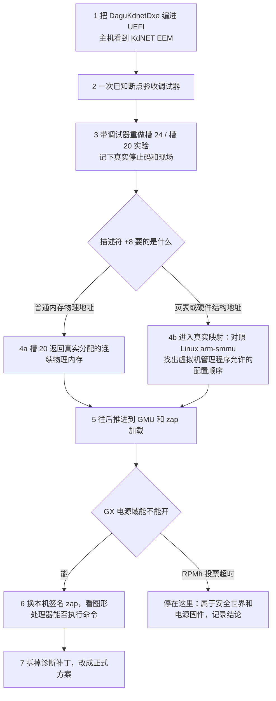

# dagu Windows 图形处理器适配：要做的调整与要准备的工具（2026-11-10）

这份文档回答两件事：让 Windows 在这块板上用上高通图形处理器驱动 `qcdx8250`，还要改哪些层；动手之前要把哪些工具备齐。各阶段的细节和实测数字以 [路线图](woa-dagu-gpu-roadmap.md)、[时间线](woa-dagu-gpu-timeline-2026-11-03.md)、[阶段 22](woa-dagu-gpu-stage22-2026-11-08.md) 为准，这里只做总览，不重复推导。

---

## 1. 现在走到哪

一句话：驱动已经能被 Windows 认到并加载，`DxgkDdiStartDevice`（适配器启动回调）一路过了孔径检查、显示模式门、显示版本门，现在停在系统内存管理单元接口的槽 24 / 槽 20。再往后要的是真实地址，不能再靠伪造对象。

| 层 | 状态 |
|---|---|
| 设备枚举 | 已通。覆盖表追加 `QCOM253A`，枚举成 `ACPI\QCOM253A\0`，`qcdxkm8250.sys` 加载 |
| ACPI（Advanced Configuration and Power Interface，高级配置与电源接口）描述 | 已补 `ENGS` / `RESI` / `TMDT` / `PMCL` / `_HRV` / `REGR`。`_ROM` 和面板配置已证伪，不是显示配置来源（[阶段 22](woa-dagu-gpu-stage22-2026-11-08.md) §2.1） |
| 图形电源域 | UEFI（Unified Extensible Firmware Interface，统一可扩展固件接口）已给图形 CX 电源域上电（[阶段 13](woa-dagu-gpu-stage13-2026-10-31.md)）。图形核心 GX 电源域没有人上电 |
| 系统内存管理单元 | 原版 `qcsmmu8250` 不能加载：碰应用处理器侧 `0x15000000` 会掉启动盘，活页表遍历会被高通虚拟机管理程序整机复位。现在用自写垫片 `dagu-smmushim` 代答接口，`map=0`，不建真实页表 |
| 驱动内部门槛 | 孔径检查、30 秒等待、显示模式类型、显示版本这几道，都是靠垫片在加载时改内存里的指令越过去的，属于诊断手段，不是正式修复 |
| 当前卡点 | 槽 24 返回区间句柄，槽 20 把句柄翻成地址写进描述符 `+8`。伪造句柄、槽 20 返回 0 时驱动拿 0 去访问硬件，触发 WHEA（Windows Hardware Error Architecture，Windows 硬件错误架构）`0x124`。改成返回 `0x9C000000` 的那一次没有记下停止码 |
| 屏幕 | 现在由 UEFI 点亮的帧缓冲 + Windows 基本显示驱动输出，能用，没有加速 |

[阶段 19](woa-dagu-gpu-stage19-2026-10-31.md) 的判断仍然成立：在原厂 HyperOS 安全固件下，图形处理器真正跑起来要过三道安全世界的关——高通虚拟机管理程序对图形系统内存管理单元走表的保护、图形核心电源轨的 RPMh（Resource Power Manager hardened，硬化资源电源管理器）投票、`zap` 安全着色器的加载认证。这三道非安全侧改不动。所以下面每一层都要先问一句：这一步是在逼近真实硬件，还是在继续伪造。

---

## 2. 要做的调整，按层

下面按从底到顶排列。每层写清楚：要什么、现在有什么、还缺什么。

### 2.1 UEFI：电源与时钟

- **已有**：`DaguPlatDxe` 给图形 CX 电源域和 GPU_CC（Graphics Clock Controller，图形时钟控制器）的总线时钟上电，Adreno 系统内存管理单元的 IDR0 在 UEFI 里能读到 `0x4C017E06`。大核调频顺带修好。
- **还缺**：图形核心 GX 电源域。Linux 主线靠 GMU（Graphics Management Unit，图形管理单元）固件加 RPMh（Resource Power Manager hardened，硬化资源电源管理器）对 `VDD_GFX` 的投票来开，而这块板上 Linux 的 RPMh（Resource Power Manager hardened，硬化资源电源管理器）总线带宽投票本身就会超时（ICC（Interconnect，片上互连）在 Linux 里也是关着的）。
- **要做的调整**：先在 UEFI 里只读探测 GX 电源域和 GMU（Graphics Management Unit，图形管理单元）的状态寄存器，确认 Windows 接手时它们是什么状态。不要在没弄清 RPMh（Resource Power Manager hardened，硬化资源电源管理器）投票之前直接写电源控制寄存器。

### 2.2 ACPI（Advanced Configuration and Power Interface，高级配置与电源接口）：设备描述

- **已有**：`port/dagu/Platform/Xiaomi/sm8250/AcpiTables/dagu/graphics-qcom253a.asl`，内容照高通参考板 MTP（Mobile Test Platform，移动测试平台）的 GPU0 节点移植。`_CRS` 里的图形寄存器已从 SM8150 的 `0x02Cxxxxx` 改成 SM8250 的 `0x03Dxxxxx`。
- **注入方式**：只走注册表覆盖表（`tools/winarm/build-gpu-overlay.py` 把节点追加在固件 DSDT（Differentiated System Description Table，差异化系统描述表）后面），不进固件，可回滚。
- **还缺**：`_DEP` 依赖列表、`_SUB`、相机子设备、显示回调这些都没补。`_DEP` 里的十个依赖节点在这块板上大多不存在，补上只会悬空。
- **不要动**：覆盖表里不能放 `QCOM2509`（系统内存管理单元）、不能放 `QCOM2519`（电源引擎插件）。前者掉启动盘，后者蓝屏 `0x101` / `0x1A`。`SOSI` 必须保持 8 字节宽。

### 2.3 系统内存管理单元：由谁来管图形的地址翻译

这是整条链上最关键的一层，也是现在卡住的那一层。

- **背景**：qcdx 不自己建页表，它通过设备接口调系统内存管理单元驱动的函数表（槽 20、24、25 等）要内存区间、要地址。原版 `qcsmmu8250` 不能用，所以由 `port/dagu/windows-drivers/dagu-smmushim/` 代答。
- **已经弄清的契约**：设备接口的 GUID（Globally Unique Identifier，全局唯一标识符）、查询缓冲 `0x1A0` 字节、版本 2；槽 25 返回子区间对象（[阶段 21](woa-dagu-gpu-stage21-2026-11-02.md)）；槽 24 分配区间句柄，槽 20 把句柄翻成地址（[阶段 22](woa-dagu-gpu-stage22-2026-11-08.md) §2.3）。
- **要做的调整，二选一**：
  1. **真实映射路线**：让垫片给 Adreno 系统内存管理单元（`0x03DA0000`，流号 0）建一套真实的页表。[阶段 18](woa-dagu-gpu-stage18-2026-10-31.md) 证明图形流的路由寄存器从 Windows 侧写得进、不会复位。复位是在 `qcsmmu8250` 的完整活配置序列里、高通虚拟机管理程序走表时发生的（[阶段 19](woa-dagu-gpu-stage19-2026-10-31.md)）。这条路要先在 Linux 里对照主线 `arm-smmu` 驱动对 Adreno 系统内存管理单元的配置顺序，找出哪一步是虚拟机管理程序允许的。
  2. **恒等映射路线**：学 Wi-Fi 那条 PCIe（Peripheral Component Interconnect Express，高速外设互连）路径的做法（`DaguPcieDxe` 在 UEFI 里给流号建 1:1 上下文），在 UEFI 阶段给图形流配好恒等映射，Windows 下不再动系统内存管理单元，槽 20 直接返回物理地址。前提是先验证高通虚拟机管理程序允许图形流走翻译上下文。
- **前置条件**：槽 20 实验那次的停止码没有记下。在 2.6 的调试器接上之前，不要再做槽 24 / 槽 20 的上板实验。

### 2.4 qcdx 驱动内部的门槛

垫片在 qcdx 映射时改写了七处指令，现在都只是诊断手段：

| 位置 | 改法 | 正式方案应该是 |
|---|---|---|
| `0x29baf0` 孔径检查 | 无条件跳过 | 弄清 UEFI 留下的孔径标志为什么让它失败，在 ACPI（Advanced Configuration and Power Interface，高级配置与电源接口）的 `_DSD` 或 UEFI 侧给出它要的状态 |
| `0x29aca0` 等四处 30 秒等待 | 超时改成 0 | 提供真正的 SCM（Secure Channel Manager，安全通道管理器）/ TrEE（Trusted Execution Environment，可信执行环境）接口，或证明驱动不需要它们 |
| `0x27a420` 版本状态 | 改比较值 | 同上 |
| `0xACB80` 显示版本 | 强制 `major=5` | 让显示版本描述如实上报 5 |

另外 `c8b2f88` 在导入槽返回点合成了显示模式类型和帧缓冲描述符，用的是 UEFI 点亮的那块 `0x9C000000`（1600×2560，32 位色，行距 6400）。这也是在没有真实 DPU（Display Processing Unit，显示处理单元）/ DSI（Display Serial Interface，显示串行接口）链路时的替代品。

正式提交前要把这些诊断改动从垫片里拆出去，单独留在一个实验分支里，见阶段 22 §7 第 4 条。

### 2.5 固件

| 文件 | Windows 包里 | Linux 里能用的 | 说明 |
|---|---|---|---|
| 安全着色器 `zap` | `qcdxkmsuc8250.mbn`，测试认证签名 | `qcom/sm8250/xiaomi/dagu/a650_zap.mbn`，本机签名 | 零售机的安全世界很可能只认本机签名。Windows 包里那份能不能过认证还没验证 |
| 命令处理器微码 | 看起来编进了驱动里 | `a650_sqe.fw`，必须是 linux-firmware 那份（31964 字节，第 2 个字 `0x112`） | Windows 驱动是否也要外部微码，还没确认 |
| 图形管理单元固件 | 没有独立文件 | `a650_gmu.bin`，Linux 能加载 v2.1.8 | Windows 下是谁给 GMU（Graphics Management Unit，图形管理单元）下固件，还没逆出来 |

`zap` 要经安全世界的 PIL（Peripheral Image Loader，外设镜像加载器）认证。Linux 里这条已通（`qcom_scm` 正常），说明本机签名那份在这块板的安全世界里能过。Windows 下要验证的是：qcdx 用的是不是同一条认证调用，能不能换成本机签名那份。

### 2.6 调试通道

- **已经能用的**：开机日志驱动写盘、注册表记录、停止码编码（把失败阶段编进蓝屏码，屏幕上直接读）、`tools/winarm/dagu-dump-triage.py` 解析页面文件里的转储。
- **还缺的**：内核调试器。`DaguKdnetDxe`（发布 DBG2（Debug Port Table 2，调试端口表 2）和 `\_SB.URS0`，退出启动服务时停掉 USB（Universal Serial Bus，通用串行总线）功能控制器）已经写好并提交，但还没编进正在跑的 UEFI 固件。见 [KDNET（Kernel Debug Network，内核网络调试）文档](woa-dagu-kdnet-eem-2026-11-08.md)。
- **要做的调整**：先把这一截编进固件、在主机上看到 KdNET EEM（Ethernet Emulation Model，以太网仿真模式）网卡、用一次已知断点证明连上了，再做 2.3 的任何上板实验。槽 24 / 槽 20 这类会触发硬件错误的实验，停止码一闪就没了，没有调试器很难取证。

### 2.7 电源引擎插件

参考板靠 `qcpep`（高通电源引擎插件，`QCOM2519`）给图形部件投票电源和时钟。这块板上它一启用就蓝屏（`0x101`、`0x1A`、`0x14B`），[阶段 5–7](woa-dagu-gpu-stage5-2026-10-30.md) 没有解释清楚。这一层放到最后，单独做，在图形处理器能跑之前不碰。

---

## 3. 要准备的工具

### 3.1 主机构建

| 工具 | 用途 | 位置 / 备注 |
|---|---|---|
| `clang-cl` / `lld-link` 21 | 编译内核驱动（垫片、探针、日志驱动） | `~/.local/llvm21`。`tools/winarm/build-kmdriver.sh` 包好了参数 |
| WDK（Windows Driver Kit，Windows 驱动开发工具包）头文件和库 | 驱动编译依赖 | `tools/winarm/fetch-wdk.sh` |
| `osslsigncode` + 测试证书 | 给驱动和目录文件签名 | `tools/winarm/sign-driver.sh`，证书在 `tools/winarm/signing/`（私钥不进仓库）。证书生效时间是 2026-10-27，平板时钟停在 2024 年时签名会失败，要先校正时钟 |
| `iasl` | 编译 ACPI（Advanced Configuration and Power Interface，高级配置与电源接口）源码 | `~/.local/acpica` |
| `tools/winarm/build-gpu-overlay.py` | 生成覆盖表并自检（长度、校验和、`SOSI` 宽度、禁用的 HID（Hardware ID，硬件标识）） | 不要手拼覆盖表 |
| Mu 构建环境 + `winarm/build-dagu-uefi.sh` | 编 UEFI（Unified Extensible Firmware Interface，统一可扩展固件接口），含 `DaguPlatDxe`、`DaguKdnetDxe` | `tools/winarm/repack-uefi-boot.py` 把新固件塞进现有启动镜像 |

### 3.2 逆向与分析

| 工具 | 用途 |
|---|---|
| Ghidra | `qcdxkm8250.sys`、`qcsmmu8250.sys` 的伪代码。qcdx 原件哈希前缀 `ff4846e4` |
| `capstone`（Python） | 按 RVA（Relative Virtual Address，相对虚拟地址）批量反汇编、扫描写入点 |
| `tools/winarm/qdis.py` | qcdx 的 RVA（Relative Virtual Address，相对虚拟地址）反汇编 + 字符串解析 |
| `tools/winarm/dagu-dump-triage.py` | 从 `MEMORY.DMP` 或页面文件里解析 ARM64 停止码、异常现场和调用栈 |
| `llvm-objdump`（带 Hexagon 后端） | 看图形管理单元、安全着色器这类 Hexagon 固件的代码。系统源里的 `llvm-21` 包自带 |
| `regipy` / `hivex` | 在 Linux 侧读写 Windows 配置单元，含回放 `SYSTEM.LOG1` / `LOG2` |
| 参考 DSDT（Differentiated System Description Table，差异化系统描述表） | `winarm/mu_aloha_platforms/.../qcom-mtp8250/ACPI/DSDT.dsl`，GPU0 在第 68113 行 |
| Linux 主线源码 | `drivers/gpu/drm/msm/adreno/`（GMU（Graphics Management Unit，图形管理单元）上电、`zap` 加载顺序）、`drivers/iommu/arm/arm-smmu/`（Adreno 系统内存管理单元的配置顺序）。Linux 侧这些都已在这块板上跑通，是最可靠的对照 |

### 3.3 设备侧操作

| 工具 | 用途 |
|---|---|
| `fb-usb.py`（中转机 `/tmp/fb-usb.py`） | `getvar current-slot`、`set-active a|b`、`reboot`。一次只切一次槽，不手改 GPT（GUID Partition Table，全局唯一标识分区表）属性 |
| B 槽 Linux + `linux-mainline/scripts/dagu-console.py` | 串口登录、挂载 Windows 分区读写文件和配置单元。有脏卷时用 `ntfsfix`（不加 `-d`）回放日志 |
| `tools/winarm/dagu-rescue.sh` | 删覆盖表、禁用 qcdx、切回 A 槽 |
| `tools/winarm/build-kmdriver.sh` + `sign-driver.sh` | 换垫片、换探针 |
| 只读探针 `dagu-gpuprobe`、受控写测 `dagu-smmuwt` | 在跑着的 Windows 里读时钟树和系统内存管理单元寄存器，判断上电和可写性 |

### 3.4 参考数据

| 项 | 值 |
|---|---|
| 面板 | L81A，1600×2560，双 DSI（Display Serial Interface，显示串行接口），DSC（Display Stream Compression，显示流压缩），120 赫兹 |
| UEFI 帧缓冲 | 基址 `0x9C000000`，大小 `0xFA0000`，行距 6400，BGRA 8888 |
| Adreno 系统内存管理单元 | `0x03DA0000`，IDR0 `0x4C017E06`，图形流号 0 |
| 应用处理器系统内存管理单元 | `0x15000000`，启动盘在它后面，不能碰 |
| 设备标识值 | `SIDV=0x00020000`，`SOID=0x164`，`SVMJ=2` |

---

## 4. 建议的推进顺序



每一步只改一处。改完都要用同一条遥测确认因果，不靠某一次碰巧过了。

---

## 5. 不要做

```text
# ❌ 覆盖表里放 QCOM2509 或 QCOM2519
# ❌ 加载原版 qcsmmu8250，或把垫片的 map 设成 1 去走实页表（会经虚拟机管理程序整机复位）
# ❌ 没有调试器时继续伪造槽 24 / 槽 20 对象（会把 0 当地址访问硬件，WHEA 0x124）
# ❌ 把七处诊断补丁当正式修复提交
# ❌ 用 elish 的 zap，或 dump 里的旧版命令处理器微码
# ❌ 在 GX 电源域状态没弄清之前写电源控制寄存器
# ❌ 一次同时改 ACPI、垫片、UEFI 三层再上板
# ✅ 先接调试器，再做会触发硬件错误的实验
# ✅ 以 Linux 主线在这块板上已经跑通的顺序为对照
```

---

### 关联文档

[路线图](woa-dagu-gpu-roadmap.md)、[时间线](woa-dagu-gpu-timeline-2026-11-03.md)、[模式合成设计](woa-dagu-gpu-mode-synth-design-2026-11-06.md)、[阶段 19（安全世界边界）](woa-dagu-gpu-stage19-2026-10-31.md)、[阶段 20（接口契约）](woa-dagu-gpu-stage20-2026-11-02.md)、[阶段 21（槽 25）](woa-dagu-gpu-stage21-2026-11-02.md)、[阶段 22（槽 24 / 20）](woa-dagu-gpu-stage22-2026-11-08.md)、[KDNET（Kernel Debug Network，内核网络调试）](woa-dagu-kdnet-eem-2026-11-08.md)、[调试手册](dagu-woa-debug-handbook.md)。
