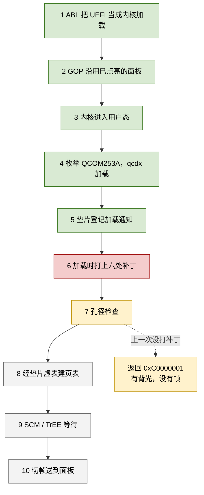
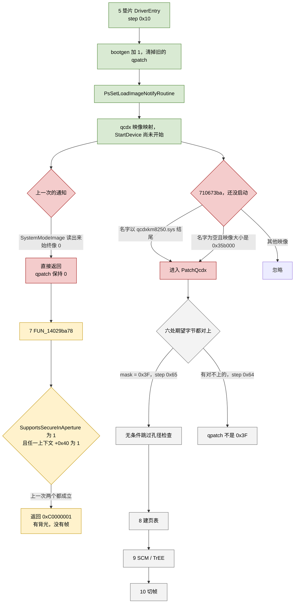
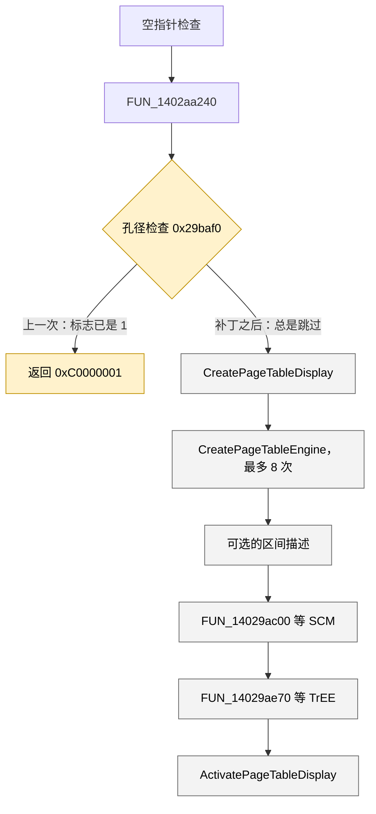
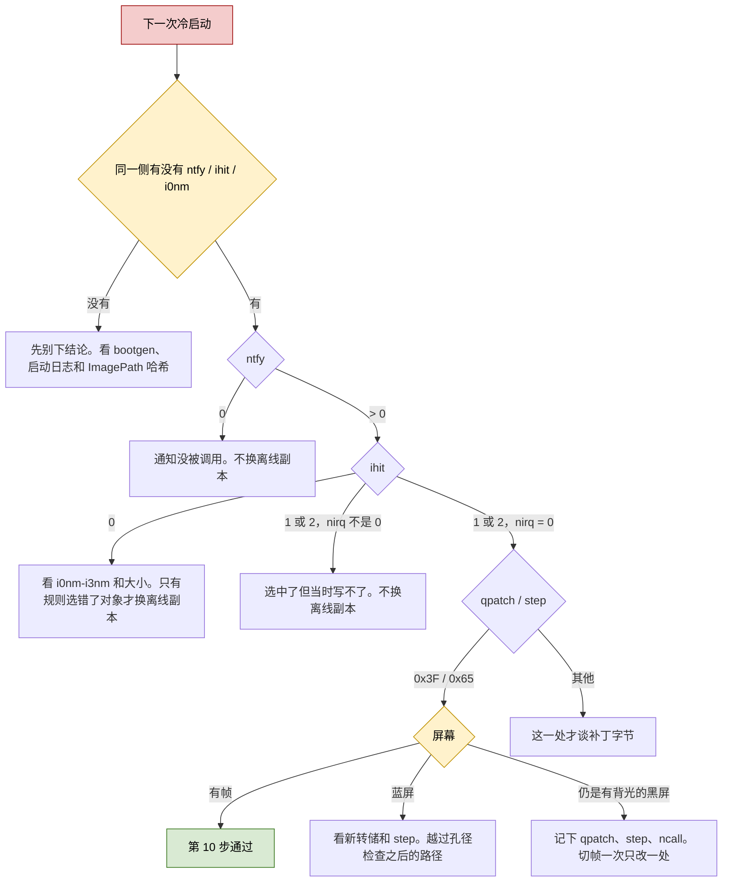

# dagu Windows GPU：进度时间线（2026-11-03）

这份文档只回答两件事：现在停在启动链的哪一步，以及哪一步还没被这次冷启动测量到。细节仍以各阶段文档为准。阶段 21 的问题码 43 已经过去，不是当前的卡点。

截至本文，平板在 Linux（B 槽，`192.168.1.51`）。A 槽这一轮没有再启动。2026-11-03 18:21 在切槽之前又读了一遍盘，整套配置单元备份在平板 `/root/pre-step6-20261103/`，主机副本在 `/tmp/dagu-boot/pre-step6/`。

---

## 几何组真值实测（2026-11-06 10:48，`bootgen=12`，Windows 蓝屏 0xDA6 后从 SYSTEM.LOG2 回放读回）

本次把现成 Windows UEFI payload 刷回 `boot_a` 后受控重启进 Windows，qcdx 跑到失败点、shim 采完整组几何字段写盘，并按 `rstonfail=1` 主动 `KeBugCheckEx(0xDA6,0x780,…)` 复位。设备蓝屏（Stop code 0xDA6）→ 落 fastboot → `set-active b`（只切一次）→ 重启回 B 槽 Linux（`192.168.1.87`，`slot_suffix=_b`）→ 挂 `sda36` 只读、regipy 回放 **LOG2**（失败那一代压在 LOG2，不是 LOG1）读回。

失败采样（`fail=0xC0000001`、`fsite=0x2c777c`、`fcall=ncall=58`、`aflt=0`、`mflt=0`、`dflt=0`，三组读取都没 fault，是真值）：

| 字段 | 值 | 含义 |
|---|---|---|
| `a630` | `1` | 显示头 0 标记有效（进入显示路径） |
| `a638` | `0xFFFF808F_E34C7000` | framebuffer 描述符指针，**非空**（内核态） |
| `a780` | **`0`** | 模式类型，硬门槛要求 `==5` |
| `a784` | `0` | 模式标志 |
| `a788` | `0` | sub-mode id（合法值应是 `0x26a0064` 等） |
| `a3b78`/`a3b7c`/`a3b90` | `0`/`0`/`0` | 几何 a/b、stride shift |
| `a46c4` | **`0x4010`**（16400） | 打包几何，**唯一非零** |
| `d1108`/`d1110`/`d1118` | `0`/`0`/`0` | 描述符内容：fb 基址 / 扫描大小 / stride，**全空** |

**结论：整个模式/几何块基本没被填充。** `a630=1`（头被标为有效）但模式三元组 `(a780,a784,a788)` 全 0、几何 `a3b78/a3b7c/a3b90` 全 0、`a638` 描述符虽非空但内容（`d1108/d1110/d1118`）全 0。仅 `a46c4=0x4010` 有值。这证实上游模式枚举在 `map=0`、垫片顶替 SMMU、无真实 DPU/DSI 链路时**完全没产出模式数据**——不是只差 `+0x780` 一个字段，而是整块空的。

**对修复的直接影响：** 单写 `+0x780=5` 远不够。要过 `319498`（`cmp w8,#5`）和 `319718`（扫描缓冲 `[+0xa8]≥0x5000`、`[+0xa0]`/`[+0x98]` 非空），再喂消费循环 `0x295cd0`，必须**合成一整套自洽的模式描述**：模式类型=5、合法 sub-mode id、几何尺寸、以及 `a638` 描述符里的 fb 基址/扫描大小/stride（可复用 UEFI GOP 已点亮的那块显存 `0x9C000000` / `0xFA0000`，见 `bootgen=9` 的 subok/suboff/subsz）。这是"伪造完整显示模式"级别的工作量，不是单点补丁。

**设备当前状态：** B 槽 Linux 在线（`192.168.1.87`）。`boot_a`=Windows UEFI payload，`boot_b`=Linux 救援槽。GPT 属性位/类型 GUID 全程未动，A 槽仍持真值 GUID。主机留有 `boot_a` 原 Linux 全量备份 `/tmp/boot_a-linux-backup-20261106-103818.img`。

---

## 当前会话状态（2026-11-06 上午，准备受控重启进 Windows）

LUN4 恢复后设备一直在线（A 槽 Linux，`192.168.1.87`，SSH key `~/.ssh/id_dagu_pulled`）。本次会话已完成：

1. **把失败链彻底逆向钉死**：唯一硬门槛是适配器 `+0x780`（模式类型）实测=0，而 `276fd0→319498` 在 `0x319660: cmp w8,#5; b.eq` 硬要求 ==5。过了这道门后 `319718` 还有第二道几何校验（模式类型∈{5,6}、扫描缓冲 `[+0xa8]≥0x5000`、`[+0xa0]`/`[+0x98]` 非空）。消费端 `0x295cd0` 是 8 次、步长 `0x6a8` 的循环，用 `[+0x630+i*0x6a8]` 当"该显示头有效"开关，逐头读 `(+0x780,+0x784,+0x788)` 模式三元组。全镜像扫描确认 `+0x780` 无任何 `str` 写入，只读；由上游模式枚举整块填充，`map=0` 下没填上。
2. **确认几何组真值从未采到**：`bootgen=9` 那次 shim 只采了 `a630/a638/a780` 三值；当前 DriverStore 里 11-05 19:09 那份 shim（`3043c763…`，37552 字节）已是几何采样版，但从未运行过一次，所以 `a784/a788/a3b78…/d11xx` 的运行时值未知。
3. **重建 Windows 启动槽**：恢复时 `boot_a` 被 Linux 覆盖。本次用 Linux 下 `dd` 把现成的 Windows UEFI payload `~/dagu-woa/boot_a-new-1103-0920.img`（`f1d11953…`，27639808 字节，kernel_sz=3403888 的 UEFI）写进 `/dev/sde12`（boot_a），回读哈希一致。`boot_b`（`/dev/sde37`）保持 Linux 作救援槽。**全程不碰 fastboot、不改 GPT 属性位/类型 GUID**。
4. **退路**：当前 GPT 槽状态健康——`boot_a` 持真值 GUID（Android boot 2）、priority=3/active=1/retry=6/successful=1；`boot_b` 占位 GUID、priority=2/active=0。A 槽本就是活动槽，直接 reboot 即进 Windows，无需切槽。hive 里 `rstonfail=1`，Windows GPU 失败后 shim 会 `KeBugCheckEx` 复位。手动兜底：长按电源+音量下进 fastboot → 主机跑 `~/dagu-woa/recover-b-when-ready.sh`（`set-active b`+reboot）。主机留有 `boot_a` 原 Linux 全量备份 `/tmp/boot_a-linux-backup-20261106-103818.img`。
5. 采样数据写进 Windows NTFS 分区 `/dev/sda36`（LUN0，与启动槽无关）的 `Services\dagusmmu\Parameters`，重启前已卸载该分区的只读挂载。

下一步：`reboot` 进 Windows，等 shim 采回几何组真值后从 Linux 挂 `sda36` 读回，据此设计 `+0x780=5` 的注入方案（shim 早期钩子或 qcdx 补丁）。

---

## 0. 最新实测（2026-11-05，离线补丁冷启动 `bootgen=7`）

这一轮用离线补丁重做了测试，推翻了两个旧假设，并把真正的失败点钉死到 qcdx 内一个此前从未触及的函数。下面是新的事实基线，第 1 节往后的旧内容仅作历史保留。

**部署方式（不碰 DriverStore 原件、不改 `oem80.inf`、不碰 catalog）：**
- 补丁版 qcdx 放到独立目录 `Windows\System32\drivers\dagu-qcdx\qcdxkm8250.sys`（`da5ffddf…`，2908336 字节，离线改好六处补丁并重签名），只把 `Services\QCDX\ImagePath` 指到这里。`Start=3` 不变。
- 新垫片换进 DriverStore `dagu-smmushim.inf_arm64_811ccbe7ca466ddc\dagu-smmushim.sys`（`826e90bf…`，34992 字节），只增强观测。`qcsmmu Start=4`、`map=0`、DSDT 39269 字节含 `QCOM253A` 均不变。
- SYSTEM 蜂箱已备份到平板 `/mnt/win/dagu/hive-backup-20261105-094800/`，主机留底 `de9c7f4b…`。

**实测结果：**
- Windows 这次转圈走完、到会话阶段才黑屏（有背光），比以往直接掉回 Linux 走得远得多。
- 加载的确实是独立路径的补丁 qcdx，`qpatch=0x3F`，`qwin` 读回六处指令字节全部是补丁后的值。**补丁真实生效。**
- 但 `ncall=0x3A`（58）、`fail=fail1=0xC0000001`、`nfail=1`，和完全不打补丁时一模一样。

**结论一（证伪"指令缓存"假设）：** 离线补丁加载即生效，`qwin` 确认内存里就是新指令，结果却毫无变化。此前怀疑的"运行时写补丁后 ARM64 指令缓存没同步"不成立。

**结论二（证伪"孔径检查是瓶颈"假设）：** 六处补丁全在 `0x27Axxx`/`0x29Axxx`（孔径检查、SCM 超时、版本 ioctl）。但 `ncall=58` 说明执行早已越过孔径检查、深入到 58 次 SMMU 槽回调之后才失败。这六处补丁解决的不是真正的瓶颈。

**真正的失败链（由垫片失败钩子 `fsite=0x2C777C` 定位，loadpatch 版在此插了跳板调用 `RecordStatus`）：**

```
qcdx 适配器初始化大函数（尾在 0x294xxx，返回 0xC0000001）
  └─ 0x2944e8  bl 0x276fd0        ; 显示模式/像素格式配置
       0x2944ec cbnz w0 → 0x29473c: mov w19,#-0x3fffffff (=0xC0000001) → 失败尾 0x2947ac
  0x276fd0 失败路径 0x2771c4: w22 = 0x80004005 (E_FAIL)
       └─ 0x2771a8  bl 0x319498   ; 用 0x2772b0/0x2772d0 两段代码 thunk 创建某对象
            0x319498 返回非零（1=入参空 / 2=分配失败 / 0x319718 结果）
```

即：真正返回 `0xC0000001` 的是 `0x276fd0 → 0x319498`，发生在孔径检查之后很远，是六处补丁完全没碰到的地方。`0x2772b0`/`0x2772d0` 不是字符串而是 ARM64 指令 thunk（含 `1f2003d5` NOP、`00001fd6` BR 模式）。

**深挖根因（2026-11-05 静态逆向，Ghidra，qcdx 原件 `ff4846e4…`，RVA 等价于 loadpatch 版）：**

失败的大函数是 `FUN_1402934b0`（RVA `0x2934b0`，StartDevice 的适配器初始化主体）。它在成功走过孔径检查、建队列、`FUN_14029ca78` 之后，到达一处**第二显示路径（framebuffer）描述符构造**的代码块，这里才真正失败：

```
FUN_1402934b0:
  ... 孔径检查 FUN_14029ba78 已通过 ...
  if (adapter+0x630 != 0) {              ; 显示路径开关：本次非 0，进入
      lVar5 = adapter+0x638;             ; framebuffer 描述符指针
      if (lVar5 == 0) {                  ; ← 本次命中这里
          iVar3 = 0xC0000001;            ; (-0x3ffffff3 的相邻失败码)
          goto 失败尾 0x2947ac;          ; 最终返回 0xC0000001
      }
      local_160 = *(lVar5 + 0x1108);     ; framebuffer 物理基址
      local_158 = *(lVar5 + 0x1110);     ; framebuffer 大小
      local_150 = *(lVar5 + 0x1118);     ; stride/格式
      ... 填入 local_140 结构的第二组字段 ...
  }
  iVar3 = FUN_140276fd0(&local_140);     ; 构造显示模式描述符
       └─ FUN_140319498: 要求描述符 [0x13]..[0x21] 全部非空，否则返回 2 → 0x80004005
```

**根因确定：** 适配器上下文 `+0x630`（显示路径使能标志）非 0，但 `+0x638`（framebuffer 描述符指针）为 0，直接返回 `0xC0000001`。`+0x630`/`+0x638` 由 `FUN_1402c9eb0` 设置，它从 `param_1[0x48]` 的显示输出表读物理地址/大小建 framebuffer 描述符。这套在真实 GOP/GPU 显存建立起来时才有值。当前 `map=0`、垫片不给真实映射，这个 framebuffer 描述符没建立，所以 `+0x638=0`。

**结论：这不是"再跳过一个检查"能解决的。** `fcall=58` 之前的槽回调都成功了，qcdx 已经走到要给显示控制器挂真实扫描输出缓冲（framebuffer 物理地址+大小）的阶段。要越过这里，必须提供一块真实的 framebuffer：要么复用 UEFI GOP 已点亮的那块显存的物理地址，把它喂进 `+0x638` 指向的描述符；要么让 `map` 建立真实映射，使 `FUN_1402c9eb0` 自己能建成。单纯 NOP 掉 `+0x630` 判断只会让更后面的切帧拿到空 framebuffer，仍然黑屏。

**下一步方向（三选一，待定）：**
1. 查 GOP 实际 framebuffer 物理地址（UEFI 已点亮面板用的那块），在垫片或补丁里把 `+0x638` 描述符指到它，让 qcdx 直接复用。风险最低、最贴近"有背光无帧"的现状。
2. 回溯 `FUN_1402c9eb0` 读的 `param_1[0x48]` 显示输出表从哪来，看能否不改显存、只补全这张表让 `+0x638` 自然建立。
3. 启用 `map=1` 走真实页表（阶段 19 已知会复位 SoC，需先解决页表正确性）。风险最高。

**修正（2026-11-05 10:xx，静态逆向 + 在线取证，两处纠正上文假设，动补丁前必须读）：**

1. **设置者归属认错了。** `+0x630` 的真正设置者是 `FUN_14025f250`（写入点 `0x25f4d0`），不是上文写的 `FUN_1402c9eb0`。实证指令：
   - `0x25f30c: madd x21,x8,x10,x21`（x10=`0x6a8`，上下文结构按 **0x6a8 字节步长**索引）
   - `0x25f334: str x0,[x21,#0x628]`（`+0x628` 存一个分配出来的指针）
   - `0x25f4d0: str w8,[x21,#0x630]`（w8=1，`+0x630` 写 **32 位标志=1**）
   - 这与失败函数 `FUN_1402934b0` 把 `+0x630` 当 int 读、`+0x638` 当 8 字节指针读一致。
   - **但 `FUN_14025f250` 只写 `+0x628`/`+0x630`，不碰 `+0x638`。** 真正给 `+0x638` 建那个大描述符（要访问到 `+0x1118`，至少 4KB）的函数**仍未定位**。上文把 `FUN_1402c9eb0` 认作 `+0x638` 设置者是错的——它写的是 0x40 字节小结构数组，offset 对不上。

1b. **更关键的 base 归属歧义（这一步新发现，推翻"同一个 +0x630"的默认假设）。** `FUN_14025f250` 的唯一调用者是 `FUN_14025f0b0`，而后者是一个 **"ENGINES" 子键遍历循环**：对每个 engine 调 `FUN_140002940` + `FUN_14025f250`，第二参 `param_2` 是**按 engine 序号 × 0x6a8 步长索引的 per-engine 上下文数组基址**。也就是说 `FUN_14025f250` 写的 `+0x630`/`+0x628` 是 **per-engine 上下文**里的字段，base 是 engine 数组元素，**不一定等于** `FUN_1402934b0` 里 `param_1`（adapter）的 base。两处的 `+0x630` 偏移相同，很可能只是巧合。
   - **因此当前连 "`FUN_1402934b0` 里 `+0x630`/`+0x638` 到底相对哪个 base（adapter 还是某 per-engine 上下文）" 都尚未钉死。** 在厘清 base 归属、找到真正建 `+0x638` 描述符的函数、拿到完整结构布局之前，**不能动补丁**——否则切帧阶段拿到字段不全/指向错误的描述符大概率蓝屏或 bootloop。

2. **方案 1 的前提这次没验证成立（但也没被否定）。** 在救援 Linux 读物理地址 `0x9C000000` 前 1MB 全为零，`/dev/fb0` 也是零。这**不能**证明"复用 GOP 显存"走不通：当前是救援 Linux 会话，不是黑屏那次 Windows/UEFI 启动；`cont_splash_region@9c000000`（size `0x2300000`）在 Linux 里是 `nomap`，且中途经过完整重启，Linux DRM 另建了自己的 framebuffer。这块显存此刻为零反映的是 Linux 状态，不是 Windows 黑屏瞬间的状态。要验证只能在 Windows/UEFI 上下文里读。

**据此，直接往 `+0x638` 填伪造描述符指针属高风险**：既没钉死真正的描述符建造者与完整结构布局，也没在正确上下文验证待复用显存有画面。切帧阶段拿到字段不全/指向错误的描述符大概率蓝屏或 bootloop，而设备当前可恢复，不应冒此险。下一步应先定位 `+0x638` 的真正建造者（沿 `0x6a8` 步长上下文、`param_1[0x48]` 显示输出表回溯），再决定注入点。

**已确认的 framebuffer 硬事实（设备侧 `/proc/iomem` + dmesg）：** 基址 `0x9C000000`、保留区 `0x02300000`（35840 KiB）、面板 1600×2560、32bpp、stride 6400、BGRA8888。这些值可信，缺的是"谁来接收、结构怎么摆"。

**追加（2026-11-05 15:xx，UEFI 源码侧交叉验证 framebuffer 地址，仅存档、非当前首选）：** 独立于设备侧，从 UEFI 源码再确认一遍 GOP 发布给 Windows 的 framebuffer，两源完全吻合：
- `PlatformMemoryMapLib.c` 的内存图里 `"Display Reserved" , 0x9C000000, 0x02400000`（36 MB，`WRITE_THROUGH_XN`）。
- GOP 驱动 `AndromedaPkg/Driver/SimpleFbDxe/SimpleFbDxe.c` 以 `LocateMemoryMapAreaByName("Display Reserved")` 取基址，发布 `Mode->FrameBufferBase = 0x9C000000`、`FrameBufferSize = 1600*4*2560 = 0x00FA0000`（15.6 MB）、`PixelFormat = PixelBlueGreenRedReserved8BitPerColor`（BGRA8888）、`PixelsPerScanLine = 1600`。
- 分辨率 PCD `PcdsFixedAtBuild.dsc.inc`：`PcdMipiFrameBufferWidth|1600`、`PcdMipiFrameBufferHeight|2560`，与上一致。

即 UEFI GOP 点亮面板用的就是 `0x9C000000`，与设备侧 `cont_splash_region@9c000000` 同址。**但这不改变结论：** 实测失败码 `0xC0000001` 来自 `0x1402944e8: bl 0x140276fd0` 返回非 0，而 `+0x638==0` 走的是返回 `0xC000000D` 的另一条分支——两者不符，所以"复用 GOP 显存填 `+0x638`"并非对症的首选修复。此地址仅作候选存档，动它之前仍需先由插桩启动取回失败点运行时真值。

**追加（2026-11-05 11:0x，继续纯静态逆向，再钉死两点）：**

3. **base 归属已钉死 = 适配器基址。** 完整复核 `FUN_1402934b0`，全程以 `param_1` 作适配器基址（`+0x3fe8`/`+0x46d8`/`+0x4584` 等），失败点读的就是 `*(int *)(param_1+0x630)` 与 `*(longlong *)(param_1+0x638)`。所以 `+0x630`/`+0x638` 是**适配器结构**字段，不是 `0x6a8` 步长的引擎上下文。`FUN_14025f250` 写在引擎基址的 `+0x630` 与此**无关**，两处偏移相同是巧合。

4. **`FUN_14029ca78` 排除。** 它紧挨在失败点之前，但只分配 0x48 字节小结构挂到适配器 `+0x2b8`、写 AVStream 摄像头注册字符串、置 `+0x2c0=1`，不碰 `+0x630`/`+0x638`。

**最终订正（2026-11-05 11:1x，汇编级控制流 + 错误码实读，推翻本节此前的根因模型，以此段为准）：**

拉了 `FUN_1402934b0` 失败区的完整汇编（x20=适配器基址），控制流是：

```
0x14029444c  ldr  w10,[x20,#0x630]      ; 使能标志(32位)
0x140294450  cbz  w10, 0x2944e0         ; +0x630==0 → 跳过整个 fb 块，直奔 0x2944e8
0x140294460  ldr  x8, [x20,#0x638]      ; fb 描述符指针(64位)
0x140294464  cbz  x8, 0x294630          ; +0x638==0 → 0x294630，返回 0xC000000D，不是 0xC0000001
0x140294468  ldr  x14,[x8,#0x1118]      ; 仅当 +0x630!=0 且 +0x638!=0 才读这三字段
0x14029446c  ldr  x15,[x8,#0x1108]
0x140294470  ldr  x13,[x8,#0x1110]
   ... 填入 sp+0x20 本地描述符，并写 x20+0x4288/+0x4290/+0x4298 ...
0x1402944e8  bl   0x140276fd0           ; 两条路径（跳过 fb / 填完 fb）都汇到这里
0x1402944ec  cbnz w0, 0x29473c          ; FUN_140276fd0 返回非 0 → 失败尾，立即数 0xC0000001
```

错误码实读（字面量池 `0x140294880` 起，小端）：`0x1402948a0 = 0xC000000D`（`+0x638==0` 分支）、`0x140294884 = 0xC0000017`（`+0x3fe8` 分配失败）、失败尾 `0x29473c` 是立即数 `0xC0000001`。

**由此推翻两条旧结论：**

- **"`+0x638==0` 直接返回 `0xC0000001`" 是错的。** `+0x638==0` 会跳到 `0x294630` 返回 `0xC000000D`（`STATUS_INVALID_PARAMETER`）。实测观测到的是 `0xC0000001`，所以**失败根本不在 `+0x638` 空指针判断上**。
- **`0xC0000001` 来自 `FUN_140276fd0` 返回非 0**，而 `FUN_140276fd0` 在"跳过 fb 块"和"填完 fb 块"两条路径上**都会被调用**。这与此前运行时垫片证据（`fsite=0x2C777C` → `0x276fd0` → `0x319498`）一致：真正的失败点是 `FUN_140276fd0`，不是 fb 描述符缺失。

**这对修复方向的影响（重要）：**

- 既然实测码是 `0xC0000001` 而非 `0xC000000D`，说明那次 Windows 启动**要么 `+0x630==0`（fb 块整段被跳过），要么 `+0x630!=0 && +0x638!=0` 但 `FUN_140276fd0` 内部仍失败**。文档此前"`+0x630!=0 && +0x638==0`"的假设与观测码自相矛盾，**该假设不成立**。
- 因此"往 `+0x638` 喂一块 framebuffer"**不一定能解决问题**：如果走的是 `+0x630==0` 路径，根本不会读 `+0x638`；即便填了，`FUN_140276fd0` 仍可能因 `FUN_140319498` 要求的描述符字段 `[0x13]..[0x21]` 不全而失败。
- `FUN_1402c9eb0` 整段已读完：它确实写自己 `param_1` 的 `+0x630`(`param_1[0xc6]`，存指针) 和 `+0x638`(`param_1[199]`，存指针)，但**都是 8 字节指针**写入，与适配器 `+0x630` 的 32 位标志读法冲突，且它无可解析调用者。结论：`FUN_1402c9eb0` 的 `param_1` **也不是适配器基址**，又是一次 `0x630` 偏移巧合，与适配器 `+0x638` 无关。真正写适配器 `+0x638` 的函数仍未定位，但**它已不是首要问题**。

**修正后的下一步（按价值排序，仍全程零风险静态）：**
1. 深挖 `FUN_140276fd0`（及其内部 `FUN_140319498`）：搞清它返回非 0 的**确切条件**——哪些输入描述符字段必须非空、这些字段从适配器哪些偏移来。这是真正的失败点。
2. 用运行时证据钉死那次启动的实际状态：让垫片/补丁在 `0x14029444c` 处记录 `+0x630`、`+0x638` 的真实值和 `FUN_140276fd0` 的返回码。只有这样才能确定走的是哪条路径。此步需要一次 Windows 启动。
3. framebuffer 复用（旧方案 1）**降级为候选**，仅当第 1 步证明 `FUN_140276fd0` 确实只缺 fb 描述符字段时才考虑。

仍未定位：真正写适配器 `+0x638` 的函数（已非首要）。framebuffer 硬事实（基址 `0x9C000000` 等，见上）仍可信，但"谁来接收、是否是瓶颈"都还没定论。

**最底层判据（2026-11-05 11:2x，`FUN_140276fd0` + `FUN_140319498` 完整伪代码，钉死真正的成功条件）：**

`FUN_140276fd0(param_1=&local_140)` 的流程：入口校验 `param_1!=0 && *param_1!=0`（`*param_1`=`lVar8`=适配器 `x20`），否则返回 `0x80070057`。随后从 `lVar8`（适配器）一批偏移拼本地描述符 `local_150`（0x128 字节）：

- `local_148 = *(int*)(lVar8+0x780)` ← **模式类型判别值**，下面要求 ==5
- `local_140 = *(int*)(lVar8+0x788)` ← 子模式（分支判 `0x26a0064`/`0x2760014`/`0x2a80014`/`0x2b2000a`）
- `uStack_144 = *(lVar8+0x784)`、`local_13c = *(lVar8+0x3b78)`、`uStack_138 = *(lVar8+0x3b7c)`
- `local_130 ← (lVar8+0x46c4)&0x7ff`、`local_124/128` 由 `+0x46c4`、`+0x3b90` 推导
- 两个子对象：`param_1[1]`（非空则取 `[2]/[0]` 和 `*(uint*)(param_1+2)`）、`param_1[3]`（非空则取 `[2]/[0]/[1]` 和 `*(uint*)(param_1+4)`）
- `local_c8/pcStack_c0 = FUN_1402772b0/FUN_1402772d0`（两个固定 thunk）

然后 `iVar1 = FUN_140319498(&local_150)`：**仅当返回 0 才成功**，非 0 → `FUN_140276fd0` 返回 `0x80004005` → 上层翻 `0xC0000001`。

`FUN_140319498(param_1=&local_150)` 的判据（param_1 下标以 8 字节计）：
- **返回 1**：`param_1[0]==0 || param_1[0x11]==0 || param_1[0x12]==0`。`[0x11]/[0x12]` 是 `FUN_140276fd0` 写死的两个 thunk（恒非零），`[0]`=`local_150`=刚分配的 `puVar3`（非零）。**返回 1 实际触发不了。**
- **走中段**：要求 `param_1[0x13]..[0x21]`（共 15 个字段）**全部非零**，否则落到 `iVar1=2` 兜底返回 2。这 15 个字段在 `FUN_140276fd0` 里**没有被显式赋值**（`FUN_140002080` 把 `local_150` 起 0x128 字节清零后，只填了前段 `[1]..[4]` 等），所以 `[0x13]..[0x21]` 位于 `local_150` 之后的栈区——**其值取决于 `local_150` 结构的真实大小与后续字段来源，这里是下一步要查的关键**。
- **返回 0（唯一成功）**：上述 15 字段全非零，且 `(int)param_1[1]==5`（即 `*(int*)(lVar8+0x780)==5`），且 `FUN_14031cb28` 返回非零、`FUN_140319718` 返回 0。

**由此得到真正的成功条件（订正：区分"硬门槛"与"非硬门槛"）：**
1. **硬门槛**：`(int)param_1[1] == 5`，即适配器 `+0x780`（模式类型）必须 == 5。否则 `FUN_14031cb28` 整段被跳过 → `FUN_140319498` 返回 2 → 失败。
2. **硬门槛**：`FUN_14031cb28(puVar17, puVar2)` 必须返回非零，且随后 `FUN_140319718` 返回 0。
3. **非硬门槛（订正上一版）**：描述符字段 `[0x13]..[0x21]`（15 个）全非零**并不是**成功的必要条件。控制流里有 `goto LAB_14031965c`：只要 thunk 对象 `puVar17 != 0`（正常都成立），即便这 15 字段有零，仍会继续走到 `param_1[1]==5` 判断。这 15 字段只决定是否构建"富对象 `puVar2`"（`FUN_14031c2d0` 分配 0x90 字节）。`puVar2` 为 0 时 `FUN_14031cb28` 是否仍能成功，取决于它对空 `puVar2` 的处理——**未读，未定**。

**两条重要caveat（防止再次基于静态误判打补丁）：**
- 上一版"15 字段必须全非零"是**过强结论**，据此已订正为非硬门槛。
- `local_150` 结构里 `[0x13]..[0x21]` 是否真的恒为零（memset 后 `FUN_140276fd0` 未显式赋值），是基于 Ghidra 对栈局部变量命名的解读得出的，**存在解读风险**：若这些字段实际由内联代码或结构尾部赋值，静态视图可能看不全。继续纯静态推下去，这类歧义只会增多。

**因此下一步的最优选择已从"继续静态"转向"一次插桩启动取运行时真值"：** 让垫片/补丁在 `0x14029444c`（读 `+0x630` 处）记录三件事——`+0x630` 实际值、`+0x638` 实际值、以及 `*(int*)(adapter+0x780)` 的模式类型值，再记 `FUN_140276fd0` 的返回码。这一次启动就能一刀切开所有静态歧义：确定那次黑屏到底走 `+0x630==0` 还是 `+0x780!=5` 还是 `FUN_14031cb28` 失败。纯静态已到达收益递减区。

**决定性验证（2026-11-05 12:xx，从离线 SYSTEM 蜂箱读回 `bootgen=7` 黑屏记录 + 反汇编逐条对齐，订正旧假设）：**

这一步没有重启硬件。平板在 Linux（`192.168.1.60`），Windows 分区只读挂在 `/mnt/win`，用 `hivexget` 把上次黑屏那次启动写进 `Services\dagusmmu\Parameters`（`CurrentControlSet`=001）的全部记录读了出来。要点与反汇编对齐后得到：

1. **失败只发生一次，落点精确。** `fail=fail1=0xC0000001`、`fcall=0x3a`（第 58 次调用）、`nfail=1`、`qpatch=0x3f`、`step=0x65`（六处补丁全部生效）。

2. **`fail=0xC0000001` 精确命中 `0x14029473c: orr w19,wzr,#0xc0000001`**（字面量赋值）。到达该失败尾的唯一路径是 `0x1402944e8: bl 0x140276fd0` 返回非 0 → `0x1402944ec: cbnz w0,0x14029473c`。

3. **订正旧假设：`+0x638==0` 空指针分支没有被命中。** 该分支在 `0x140294630`，返回的是从文字池取的 `0xC000000D`，与实录 `0xC0000001` 不符。文档前文"卡在 `+0x638=0`、需要喂 framebuffer"的推断据此**排除**。真正失败是 `FUN_140276fd0` 内部返回非 0。

4. **插桩锚点已确认：** adapter 指针从 `0x1402934dc: mov x20,x0` 起全程在 `x20`。`+0x630` 读取在 `0x14029444c`，`+0x638` 读取在 `0x140294460`，失败调用在 `0x1402944e8`。失败主体 `FUN_1402934b0` 对 `+0x630/+0x638/+0x780` **只读不写**，三值在更早的初始化里由别的函数设置（`+0x630` 由 `FUN_14025f250` 在 `0x14025f4d0` 无条件写 1，但该函数不写 `+0x780`）。所以三值在失败点的真实取值只能靠运行时观测。

5. **当前已部署的 shim 拿不到这三值。** shim 把 `RecordStatus` 函数指针写进 qcdx 的 `base+0x1c66c0` 槽，由 qcdx 从 `0x140133854`/`0x140133a2c`/`0x140133b0c` 三处调用，**只传 `status`**，无法访问失败点的 `x20`。蜂箱里那批 `q*`（`qwin/qpte/qexc/wstat/wprot…`）是 SMMU 页表/异常现场，不是 `+0x630/+0x638/+0x780`。**结论：文档要求的"三值插桩"至今从未真正构建、从未部署过一次。**

6. **工程约束：生成补丁版 qcdx 的 loadpatch 工具源码不在本仓库**，只有产物 `tmp/step7-deploy/qcdx-loadpatch-testsigned.sys`（2908336 字节）与留底 `/root/pre-step6-20261103/qcdxkm8250-loadpatch.sys`。`fsite=0x2c777c` 超出原件 raw 镜像范围、在原件里解码为"代码空洞"，说明 loadpatch 是**在镜像尾部追加了一段 trampoline**并把失败尾改跳到那里（这正是它能记 `fsite` 的原因）。要读三值，需在这段已存在的 trampoline 里用 `x20` 多读三个偏移。

**三值插桩已实现并部署（2026-11-05 13:xx，只改 shim，不重打补丁、不重签 qcdx）：**

打开 loadpatch 产物 `qcdx-loadpatch-testsigned.sys`（`da5ffddf…`）后看清了 trampoline 的构造。它不在镜像尾部，而是复用原件 `0x2c7768` 处的一段代码洞，失败主体末尾 `0x1402947f8` 改跳到这里：

```
0x1402c7768: adrp x16, 0x1401c6000
0x1402c776c: ldr  x16, [x16, #0x6c0]   ; 取 shim 写进 base+0x1c66c0 的指针
0x1402c7770: cbz  x16, 0x1402947fc     ; 空则跳过
0x1402c7774: mov  w0, w19              ; w19 = 失败状态 0xC0000001
0x1402c7778: blr  x16                  ; 调 shim 的记录函数
0x1402c777c: b    0x1402947fc          ; 回失败尾 → 这就是 fsite=0x2c777c
```

关键发现：trampoline `blr` 时 **adapter 仍活在 `x20`**（callee-saved，要到 `0x2947fc` 的 epilogue 才恢复），且上次 `nfail=1` 证明整个启动只经过这一次。所以**不必碰 qcdx 补丁**，只要把 shim 写进 `0x1c66c0` 的指针改指到一个能读 `x20` 的裸桩即可。

已在 `port/dagu/windows-drivers/dagu-smmushim/dagu-smmushim.c` 实现：
- 新增裸函数 `RecordStatusThunk`（`__attribute__((naked))`）：`mov x1,x20` 后 `b RecordStatus` 尾跳。用 `b` 不用 `bl`，保留 trampoline 设的 `lr`，故 `RecordStatus` 里 `__builtin_return_address(0)` 得到 `0x2c777c`，且返回时直接回 trampoline。反汇编产物已核对字节 `aa1403e1`(`mov x1,x20`)+`17ffed38`(`b`)。
- `RecordStatus(status, adapter)` 加第二参数。仅当 `site==0x2c777c`（trampoline 专属，另外三处通用 hook 点的 `x20` 不是 adapter）时，`__try` 包裹读 `+0x630/+0x638/+0x780`，写新键：`adlo/adhi`（adapter 指针）、`a630`、`a638lo/a638hi`、`a780`（模式类型）、`aflt`（读故障=1）。
- hook 安装点改为写 `RecordStatusThunk`；`ClearStale` 加入这些新键，避免上个 bootgen 残留。

构建/签名/部署（全部完成）：
- `tools/winarm/build-kmdriver.sh dagu-smmushim` → `f7ff6f4b…`，36016 字节；`tools/winarm/sign-driver.sh` 用同一测试 PKI 签名（根 CA `8FF85DFF…`，即 `826e90bf` 垫片加载成功用的那套，信任链已在镜像内）。
- 以 ntfs-3g 读写重挂 `/mnt/win`（`remount` 对 fuseblk 是空操作，必须真正 umount 再挂），覆盖 DriverStore `dagu-smmushim.inf_arm64_811ccbe7ca466ddc\dagu-smmushim.sys`，落盘复核 `f7ff6f4b…`/36016 字节，已重挂回只读。
- 旧垫片 `826e90bf…` 回退副本在主机 `tmp/step7-deploy/dagu-smmushim.sys`（设备侧那次 backup 未落盘，但此留底完好）。
- 启动前复核：补丁 qcdx `da5ffddf…` 在独立路径、`QCDX ImagePath` 指向它、`Start=3`；`qcsmmu Start=4`；`map` 未设（=0，不走实页表、不复位 SoC）；`bootgen=7`（下次启动写 8）。

**这次插桩启动要读的键（启动黑屏后回 Linux，从 SYSTEM 蜂箱 `Services\dagusmmu\Parameters` 读）：**
- `nfail` 应仍为 1、`fsite` 应仍为 `0x2c777c`（确认走的还是这条 trampoline）
- `aflt`：若为 1 说明三值读取本身故障，其余值作废
- `a630`：显示路径开关。==0 → framebuffer 填充块整段被跳过
- `a638lo/a638hi`：framebuffer 描述符指针
- `a780`：模式类型。`FUN_140276fd0` 的硬门槛要求 ==5，≠5 则 `FUN_14031cb28` 整段被跳过→失败

这一次就能一刀切开 `+0x630==0` / `+0x780!=5` / `FUN_14031cb28` 失败三种可能，定出修复方向。**下一步：把平板从 fastboot `set-active a` 后重启进 Windows（A 槽），黑屏后手动重启回 fastboot，再 `set-active b` 回 Linux 读键。**

**决定性结果（2026-11-05 15:xx，`bootgen=9` 插桩启动实测，三值到手，推翻 framebuffer 方向，以此段为准）：**

插桩启动按计划执行：A 槽启动→有背光黑屏→手动回 fastboot→切 B 槽回 Linux。这次启动的数据先落在 `SYSTEM.LOG1`（3.7MB，未 checkpoint 进主单元），用 `regipy.recovery.apply_transaction_logs` 回放 593 个脏页后读出 `Services\dagusmmu\Parameters`：

| 键 | 实测值 | 解读 |
|---|---|---|
| `bootgen` | `0x9` | 确认是本次插桩启动 |
| `nfail` / `fail` / `fail1` | `1` / `0xC0000001` / `0xC0000001` | 失败一次，码与 bootgen=7 一致 |
| `fsite` / `fsite1` | `0x2c777c` / `0x2c777c` | 走的就是 trampoline，三值可信 |
| `fcall` / `ncall` | `0x3a` / `0x3a` | 第 58 次调用失败，与 bootgen=7 一致 |
| `aflt` | `0` | 三值读取无故障，值全部可信 |
| `adlo/adhi` | `0xffffb78f_8f424000` | adapter 指针（合法内核地址） |
| **`a630`** | **`0x1`** | 显示路径使能 = 1，**fb 填充块进入了，没有被跳过** |
| **`a638lo/a638hi`** | **`0xffffb78f_922cc000`** | **fb 描述符指针非空！合法内核地址** |
| **`a780`** | **`0x0`** | **模式类型 = 0，而硬门槛要求 == 5** |
| `step` | `0x61` | 失败钩子 `RecordStatus` 跑完（`Step(0x61)`） |
| `qpatch` | `0x3f` | 六处补丁全部生效 |
| `ntfy` | `0x7900`（30976） | 这次走得很远，不是早冻 |

**三条决定性结论：**

1. **framebuffer 方向彻底排除。** `+0x630==1`（使能）、`+0x638` 非空（描述符已建好，是合法内核指针 `0xffffb78f922cc000`）。qcdx 自己已经把 fb 描述符建立起来了，**不缺 framebuffer，也不需要复用 GOP 的 `0x9C000000`**。此前"喂 framebuffer 进 `+0x638`"的整条方向（旧方案 1）据实测**正式作废**，GOP 地址仅留作历史存档。

2. **真正的卡点是 `+0x780`（模式类型）== 0，而 `FUN_140276fd0`→`FUN_140319498` 的硬门槛要求它 == 5。** 这是 `fail=0xC0000001` 的直接原因：`a630`/`a638` 都正常，fb 块填完后汇入 `0x1402944e8: bl 0x140276fd0`，该函数因 `(int)param_1[1]!=5`（即 adapter `+0x780!=5`）走 `FUN_14031cb28` 被跳过的路径 → `FUN_140319498` 返回非 0 → `0x80004005` → 上层 `0xC0000001`。

3. **下一步方向转向 `+0x780`：** 需要查清 adapter `+0x780`（模式类型）由谁、在何时、依据什么设置，为什么冷启动路径下它是 0 而不是 5。这是新的、唯一的根因焦点。`+0x780` 由 `FUN_140276fd0` 以 `local_148 = *(int*)(lVar8+0x780)` 读取，写入者尚未定位——这是下一轮纯静态逆向的起点（零风险、不需启动硬件）。

**写入者已定位（2026-11-05 15:4x，纯静态逆向，钉死 `+0x780` 的来源，推翻"逐字段写入"的找法）：**

花了一轮把"谁写 `+0x780`"这条链彻底打通，结论分三层。

**A. `+0x780` 不是被逐字段写的，而是一整块 `memcpy` 搬进来的。** 对全镜像（`.text`+`PAGE`）做了穷举反汇编扫描，覆盖三种存储形式：立即数位移 `str Wt,[Xn,#0x780]`、寄存器变址 `str Wt,[Xn,Xm]`（Xm 曾被赋 `0x780`）、拆分基址 `add Xn,adapter,#0x700` 后小位移存储。**三种形式对整个模式块（`+0x780/784/788/3b78/3b7c/3b90/46c4`）全部零命中。** 这证明 qcdx 里没有任何字段级指令写这些偏移——此前"按偏移反查写入者"的找法从一开始就不可能命中，纯静态在这条路上零收益是结构决定的，不是漏扫。

**B. 真正的填充点是 `FUN_1402ac3c0`（资源描述符导入）。** 它的 `param_1` 是 adapter（入口校验 `(int)param_1[0xf] != -0x21524111`，即 `0xDEADBEEF` 签名），`param_2` 是一张资源/能力描述表。函数开头两次 `FUN_140002260`（已核实是完整的 `memmove`：重叠处理 + 128/64/32/16/8 字节分块复制）：
- `memmove(局部缓冲, param_2, 0xcd0)`
- `memmove(param_1 + 0x62, 局部缓冲, 0xcd0)` —— `0x62*8 = 0x310`，把这张 3280(`0xcd0`) 字节的表整块搬进 **adapter+0x310**，覆盖范围 `[0x310, 0xfe0)`，**正好含 `+0x780`**。

即 adapter `+0x780`（模式类型）的值直接等于输入描述表里对应偏移的字节。冷启动下它是 0 而不是 5，说明**那张传进来的描述表在该位置就是 0**——不是 qcdx 算错，而是上游喂给它的模式/能力描述表里模式类型字段为空。

**C. adapter 里有"待提交"和"已激活"两份同布局模式块，间距固定 `0x9b4`。** 另两个函数操作的是另一份：
- `FUN_1402b55d8`（模式选择器，引用含四个子模式魔数 `0x2760014/0x26a0064/0x2a80014/0x2b2000a` 的模式表 `0x1402b5c40`）把 `+0x1134` 无条件写成 `5`、按选择器把子模式写进 `+0x113c`；
- `FUN_1402ac3c0` 读 `+0x1134/+0x113c`。
- 对照消费者 `FUN_140276fd0` 读的 `+0x780/+0x788/+0x784`：`0x1134−0x780 = 0x113c−0x788 = 0x1138−0x784 = 0x9b4`，两份块逐字段对齐。
- `FUN_140295c50`（一个 DDI 回调，与失败函数 `FUN_1402934b0` 同在 `.rdata` 分发表 `0x14014b044` 起）也读 `+0x780/+0x3b78/3b7c/3b90`，是第二个消费者。

**这对修复方向的影响：**
- 根因进一步前移：失败不在 qcdx 的模式处理逻辑，而在**喂给 `FUN_1402ac3c0` 的那张描述表**（`param_2`，`0xcd0` 字节）——它的 `+0x470`（表内偏移，对应 adapter `+0x780`）为 0，导致下游 `FUN_140276fd0` 的硬门槛 `==5` 不满足。
- 下一步（纯静态）：查 `FUN_1402ac3c0` 的 `param_2` 从哪来——它没有可解析的直接调用者（通过函数指针/DDI 间接调用），需要从资源枚举/`StartDevice` 侧或 `param_2` 的构造点反查，确认这张表是固件 ACPI/DSD 提供、还是 qcdx 内部按平台 ID 生成。这决定了修复是补 ACPI 描述、还是补 qcdx 的模式默认值。

**订正（2026-11-05 15:5x，对象身份核对，撤回上一段 B/C 的两处过度断言）：** 上一段把「`memcpy` 填的对象」直接当成「门控读的大 adapter」，并用固定间距 `0x9b4` 把两份模式块绑成同一对象——这是又一次偏移算术巧合，证据不足，现撤回。核对如下：

- **门控消费者读的是一个 ≥ `0x46c8` 字节的大对象。** `FUN_140276fd0` 从同一基址 `x22 = *param_1` 上成组读 `+0x780`、`+0x784`、`+0x788`、`+0x3b78`、`+0x3b7c`、`+0x3b90`、`+0x46c4`（`+0x46c4 = 18116`）。失败函数 `FUN_1402934b0` 的 adapter（`x20`）还读 `+0x3fe8`、`+0x46d8`。这个对象至少 `0x46c8` 字节。
- **`memcpy` 填充的是一个 `0x1c10`(7184) 字节的小对象。** `FUN_1402aebe0` 里 `alloc(0x1c10)` 建这个对象，装进设备虚表（`param_3[0]=FUN_1402ac3c0` 等），`FUN_1402ac3c0` 把 `0xcd0` 资源表 memcpy 到它的 `+0x310`（覆盖到 `+0xfe0`）、对 `param_1` 的最大触及是 `KeInitializeMutex(param_1+0x1ab0)`。这个对象**装不下** `+0x3b78`/`+0x46c4`，与门控大对象不是同一个。
- **两组偏移在全镜像零交集。** 穷举所有对 `+0x780/3b78/3b90/46c4`（门控组）和 `+0x1130/1134/113c`（模式选择组）的内存引用：**没有任何一个函数在同一基址寄存器上同时碰这两组**。`+0x780+3b78+3b90` 只在 `FUN_140276fd0`(x22)/`FUN_140295c50`(x21) 成组出现；`+0x1130/1134/113c` 只在 `FUN_1402b5xxx`/`FUN_1402acxxx`/`FUN_1402aexxx` 出现。两套字段分属两个结构。

**撤回后，确定的部分 vs 未定的部分：**
- **仍确定（A 层不变）：** qcdx 里没有任何字段级指令写 `+0x780` 这组偏移；它们是整块 `memcpy` 搬进来的。按偏移反查写入者的找法结构上不可能命中。
- **仍确定：** `FUN_140276fd0` 的硬门槛是读对象 `x22` 的 `+0x780 == 5`，冷启动实测为 0。
- **撤回：** 「`+0x1134` 与 `+0x780` 是同布局两份、间距 `0x9b4`」、「adapter `+0x780` 由 `FUN_1402ac3c0` 那次 memcpy 填充」。`FUN_1402b55d8` 把 `+0x1134` 写成 5、`FUN_1402ac3c0` 把资源表填进 `+0x780` 的，都发生在那个 `0x1c10` 小对象上，**不是**门控读的大 adapter。
- **新的未定焦点：** 门控大对象（`x22`，≥`0x46c8` 字节）的 `+0x780` 由谁填。它既不是逐字段写（A 层），也不是 `FUN_1402ac3c0` 那次 memcpy（对象不符）。下一步应从 `FUN_1402934b0` 入口反查 `x20`/`x22` 这个大 adapter 的分配点与初始化 memcpy，定位真正写它 `+0x780` 的那次整块拷贝的源。

**失败函数的 DDI 身份已钉死（2026-11-05 15:5x，`DRIVER_INITIALIZATION_DATA` 布局比对）：失败函数 `FUN_1402934b0` 就是 `DxgkDdiStartDevice`。** 证据链：
- `FUN_1402934b0` 的函数指针引用有三处，其一 `0x1400138e0` 落在 DriverEntry（`FUN_1400137xx`）里搭建 `DRIVER_INITIALIZATION_DATA` 的赋值群。
- 该赋值群从 `0x1400138c4` 起：`sp+0x50` 写版本号 `0xf003`（`DXGKDDI_INTERFACE_VERSION`），随后按 WDDM 固定布局排回调指针——`sp+0x58`(+0x08)=`DxgkDdiAddDevice`=`0x1402932c0`，`sp+0x60`(+0x10)=`DxgkDdiStartDevice`=`0x1402934b0`。偏移 `+0x10` 正是 `StartDevice` 槽。
- 反向印证：`0x1402932c0`（AddDevice 槽）只有 480 字节、4 个局部变量，是典型的 `DxgkDdiAddDevice`（只分配适配器上下文），布局自洽。

**这对根因定性的意义：** `+0x780`（模式类型）在 `DxgkDdiStartDevice` 阶段被硬门槛要求 `==5`。StartDevice 体内对主 adapter（`x20`）的唯一 memcpy 是 `memcpy(x20, x22src, 0x238)`（`0x140293634`），只写 `[0,0x238)`，够不到 `+0x780`；寄存器变址 store 只写到 `+0x46c4` 等能力字段，也不碰模式块。因此在 StartDevice 跑到致命的 `bl 0x140276fd0` 之前，主 adapter 的 `+0x780` 没有被这条路径填过。两种可能：要么 `+0x780` 本应由更早/别处的整块拷贝填好而冷启动下没填（保持 memset 的 0），要么 WDDM 模型里模式类型本不该在 StartDevice 判定、qcdx 在此处的 `==5` 门槛是对某个「已协商显示模式」的前置依赖，而冷启动无显示输出协商 → 值为 0。下一步仍是反查主 adapter 分配点与其 `+0x780` 的填充源。

**主 adapter 分配点已钉死（2026-11-05 15:5x，`DxgkDdiAddDevice` 伪代码）：主 adapter 是 `DxgkDdiAddDevice`（`FUN_1402932c0`）里 `ExAllocatePoolWithTag(NonPagedPoolNx, 0x4ea8, 'q X0')` 分配的 20136 字节对象**（`0x4ea8` 容得下 `+0x46c4`，与门控对象 `x22`≥`0x46c8` 吻合）。`AddDevice` 把它写回 `*param_2`（DXGK 保存为 adapter 上下文，后续 StartDevice 原样收到），然后**除了 `KeInitializeMutex(+0x43e8)` 之外不初始化任何字段**——`+0x780` 在 AddDevice 阶段不被置值，由 `ExAllocatePoolWithTag` 的非零池保证它不一定是 0（NonPagedPoolNx 不清零）。这把「谁填 `+0x780`」彻底收窄到 StartDevice 自身及其子调用链：要么 StartDevice 子调用里有一次整块拷贝把模式块填进 `+0x780`（冷启动下未发生或填了 0），要么 qcdx 预期 `+0x780` 由更早的某个 DDI（如 `QueryAdapterInfo`/显示模式协商）填好而冷启动缺这一步。**下一步聚焦 StartDevice 在 `bl 0x140276fd0` 之前的子调用里，哪一个以 `x20+0x780` 或其附近为目标做整块写。**

**穷举结论（2026-11-05 16:0x，全镜像扫完所有候选写入形式，排除三类假目标）：对主 adapter `+0x780` 的「字段级写者」在镜像里不存在，模式块值来自属性存储按键名回填，而冷启动下这条回填路径被条件分支跳过——这是当前最可信的根因模型，但仍缺一次运行时确认。** 本轮穷举覆盖并排除了：

1. **字段级 store（含 `movz/movk` 拼常量的寄存器变址）全空。** 对 `+0x780/784/788/3b78/3b7c/3b90` 三种 store 形式扫描全零命中。对照同一主 adapter 的能力字段 `+0x46c4`：它**有**寄存器变址写者（`FUN_14029eb80`、`FUN_140261500`，后者同基址还写 `+0x3b98/+0x3fe8` 等 adapter 专属大偏移，证明其基址 `x19` 就是主 adapter）。即「同一对象上 `+0x46c4` 有写者、`+0x780` 没有」被双向证实。

2. **主 adapter 的能力/配置字段是从一个属性存储按「键名」回填的，不是硬编码。** `FUN_140261500`（StartDevice 子调用）里有一长串 `add x2, 键名页, #off` + `bl FUN_14026e3d0` 序列。`FUN_14026e3d0(adapter, ctx, 键名, 输出buf)` 从 `adapter+0x46e0` 的句柄经 `FUN_140270058` 查属性，把值写进第 4 参数指向的 **adapter 输出偏移**（如 `+0x40c4`、`+0x470c`、`+0x457c`）。`+0x780` 模式块很可能也走同一机制，由某个键回填；键缺失/查询失败时该偏移保持调用前的值。

3. **三类「0x780 假目标」全部排除，避免再犯偏移巧合：**（a）`FUN_1402ac3c0`/`FUN_1402c0230`/`FUN_1402ddc40` 的三处 `0xcd0` memmove，目标都是 ≤`0x1c10` 的小对象，非主 adapter；（b）`FUN_1402ee710` 里 `memset(x21+0x778,0x108)`+`FUN_140045550` 这组「先清零模式块再填」的代码，`x21` 最大偏移仅到 `0x125c`，够不到 adapter 专属 `+0x3b78/+0x46c4`，是独立子对象；（c）四处 `add x3, 页基址, #0x780`（`0x14003924c` 等）全是 `adrp+add` 拼的 rodata 字符串指针，传给日志/格式化函数，与 adapter 无关。

**对修复方向的意义：** 根因模型收敛为「主 adapter 的模式类型 `+0x780` 由属性存储回填，冷启动下该回填被跳过或返回 0 → `DxgkDdiStartDevice` 的 `FUN_140276fd0` 硬门槛 `==5` 不满足 → `0xC0000001`」。但「`+0x780` 具体由哪个键、在哪段回填、冷启动为何跳过」还差一步静态确认，且属性存储内容只有运行时才有真值。**纯静态在此再次逼近收益递减**：建议下一次插桩启动直接取三样——`FUN_140276fd0` 入口处 `*(int*)(adapter+0x780)` 实际值、`adapter+0x46e0` 属性句柄是否非空、以及 `FUN_140261500` 那串属性查询里与模式相关的键的返回码。这能一刀确认回填路径是否跑过。

**附：这次 hive 没有被写坏。** 刷盘加固（`gPendValid` 消费一次清零 + 心跳降到每 256 次）生效：bootgen=9 全程只在 `SYSTEM.LOG1` 累积事务、主单元未被撕裂，回 Linux 后 `ntfsfix` + regipy 回放即完整恢复，没有再出现 `0xc000014c`。

---

## 1. 现在停在哪

**当前位置：垫片会在 qcdx 映射完成时打上六处补丁，匹配失败时会写下通知次数、最近四个映像和命中方式。这份带记录的垫片已经换进 DriverStore，还没有跑过一次。**

**卡点：上一次冷启动的加载通知把 qcdx 跳过了，六处补丁一处都没写。`StartDevice` 因此停在孔径检查，页表和切帧都没开始。**

上一次冷启动已经走过第 1 到第 5 步。第 6 步的修正已经落在盘上，测量它的那次启动还没做。第 7 步是上一次实际返回的地方，不是还要去找的新故障。

| | 状态 |
|---|---|
| 系统能进用户态 | 已通过。内核是硬链接的 26100.1。黑屏时没有新的蓝屏转储 |
| 面板 | 有背光，没有帧。固件把屏点亮了，Windows 没有把画面送出去 |
| qcdx | Start=3，按需启动。上一次冷启动已加载。映像是诊断版，2908336 字节，`8e77bf1e…`。仓库里的另一份不要换上去 |
| 原版 qcsmmu | Start=4，不加载。它会碰 APPS SMMU `0x15000000`，UFS 启动盘会掉 |
| 垫片 dagusmmu | Start=3。`map` 保持 0，不走实页表，不写 `0x03DA0000` |
| qcif | 上一次已加载。它发布 SCM / TrEE 接口，ioctl 返回 `0xC0000010`。映像加载不等于这些接口已经被 qcdx 打开 |
| 上一次补丁结果 | `qpatch` 仍是 0。当时的通知读错了 `SystemModeImage` 位域 |
| 已装上、还没启动的垫片 | DriverStore `710673ba…`，28336 字节。`ImagePath` 指向 `dagu-smmushim.inf_arm64_811ccbe7ca466ddc\dagu-smmushim.sys`，读回哈希就是这一份。通知回调只改内存，记录由工作项刷出，不依赖槽回调 |
| 上一版未启动过的垫片 | `552c40a9` 和会在回调里写注册表的 `62afd290…` 都已换下，副本在 `/root/pre-step6-20261103/` |
| 离线补丁副本 | `/root/pre-step6-20261103/qcdxkm8250-loadpatch.sys`，`30803ec5…`。六处已按期望值改好。DriverStore 里的 qcdx 仍是原件 `8e77bf1e…` |
| 启动前复核 | 垫片读回是 `710673ba…`，28336 字节。DSDT 39269 字节，校验和 0，有 `QCOM253A`，没有 `QCOM2509`。QCDX Start=3，qcsmmu Start=4。qcdx 仍是 `8e77bf1e…` |
| A 槽重试 | GPT 属性 `0x0032000000000000`：retry 6，successful 0，unbootable 0。再启动一次会变成 5 |
| 回到 B 槽 | 当前 `androidboot.slot_suffix=_b`。`boot_b` 属性 `0x0077000000000000`：active、successful。fastboot 里 `set-active b` 再 reboot 即可回来 |

---

## 2. 一次冷启动里的步骤



绿色是上一次冷启动已经通过的。红色是当前卡点，修正已经在盘上，还没跑。黄色是上一次实际返回的位置。灰色还没被这次冷启动碰到。

| 步 | 发生什么 | 上一次冷启动 | 盘上还没跑的修正 |
|---|---|---|---|
| 1 | ABL 把签过名的 UEFI 当成 Linux 内核加载 | 已通过 | 不改 ABL，不刷 boot |
| 2 | XBL 已经点亮面板。UEFI 的 SimpleFb 把这块帧缓冲交给 GOP | 已通过。ExitBootServices 大约 3.8 秒。源码里的 30 秒 PCIe 停顿不在已经刷进 A 槽的固件里 | 不回退这份 UEFI，也不把当前 SimpleFb 源码刷进去 |
| 3 | 内核进入用户态 | 已通过。0xA、0x6B、0xC0000428 都是版本错位，硬链接成一套 26100.1 之后不再出现 | 不换内核、不换 ntdll |
| 4 | 覆盖表追加 GPU0。PnP 枚举 `ACPI\QCOM253A\0`，qcdx 加载 | 已通过。表里有 `QCOM253A`，没有 `QCOM2509`。`_STA` 返回 `0x0F` | 不重建覆盖表。源码里的 `SupportsSecureInAperture Zero` 不是现用表，现用值是 1 |
| 5 | 垫片 DriverEntry 把 `bootgen` 加 1，清掉上一轮的 `fail` / `ncall` / `qpatch`，再登记加载通知 | 已通过。通知登记成功，所以 `step` 不是 `0x11`。`bootgen=2` 只出现在 `SYSTEM.LOG1` | 同一套登记逻辑还在 |
| 6 | qcdx 映像一映射就写六处，此时 `StartDevice` 还没运行 | **卡在这里。** 位域检查把 qcdx 跳过，`qpatch` 保持 0 | `710673ba…` 在回调里只改内存。工作项随后写下 `ntfy` / `ihit` / `i0`–`i3`，不等槽回调 |
| 7 | `FUN_14029ba78` 看孔径标志 | 两个条件都成立，返回 `0xC0000001`，后面的调用都没发生 | `0x29baf0` 改成无条件跳过。还没被测量 |
| 8 | `FUN_14029b168` 建显示页表和最多 8 份引擎页表，经 `FUN_1402aa7e0` 调垫片虚表 | 未到。页表函数的唯一调用者就是第 7 步那个函数 | `map` 仍是 0 |
| 9 | `FUN_14029ac00` 等 SCM，`FUN_14029ae70` 等 TrEE，然后做版本查询 | 未到。这两次等待排在孔径检查和页表循环之后 | 超时改成 0，版本状态改成 `0xC0000001` |
| 10 | `ActivatePageTableDisplay` / `ForceSeamlessBootTransition` 把帧送进已经点亮的面板 | 未到 | 只有 `qpatch=0x3F` 而屏幕仍黑，才轮到这里 |

### 2.1 第 6 步和第 7 步怎么连在一起

加载顺序是垫片、qcif、qcdx。垫片先登记通知。qcdx 被映射时通知先跑，qcdx 自己的 `DriverEntry` 和更后面的 `StartDevice` 都还没开始。所以上一次不是「补丁打晚了」，而是「补丁函数没被叫到」。



`FUN_14029ba78` 内部的顺序是固定的。孔径检查在页表之前，SCM / TrEE 又在页表之后：



孔径检查读的是适配器 `+0x422c`，以及 `+0xc50`、`+0x4070` 两个上下文对象各自的 `+0x40`。`+0x422c` 来自现用 `_DSD` 的 `SupportsSecureInAperture`，值是 1。两个 `+0x40` 在冷启动时已经是 1，那是固件 GOP 留下的孔径。页表函数 `FUN_14029b168` 的唯一调用者就是这个函数，所以槽回调不可能发生在这次返回之前。等第一次槽回调再打补丁，时间已经晚了。

### 2.2 六处补丁各自改什么

诊断映像的这六个字在盘上仍是期望值，补丁只写被映射进内存的那份，不改文件。

| 位 | RVA | 期望 | 改成 | 作用 |
|---|---|---|---|---|
| 0 | `0x29baf0` | `CBZ w8`，`0x34000248` | 无条件分支 `0x14000012`，目标仍是 `0x14029bb38` | 跳过孔径失败返回 |
| 1 | `0x29aca0` | `mov w2, #30000` | `mov w2, #0` | SCM 等待的超时 |
| 2 | `0x29af10` | `mov w2, #30000` | `mov w2, #0` | 另一处 30 秒等待 |
| 3 | `0x29afc4` | `mov w2, #30000` | `mov w2, #0` | 另一处 30 秒等待 |
| 4 | `0x29b070` | `mov w2, #1000` | `mov w2, #0` | 1 秒等待 |
| 5 | `0x27a420` | 立即数 `0xC0000010` | `0xC0000001` | 两次版本 ioctl 共用的比较值 |

六位全写上时 `qpatch` 是 `0x3F`，`step` 写成 `0x65`。少一位就是 `0x64`，并把「已经补过」的标志清掉。

超时改成 0 的依据是 `FUN_140284e38`：超时参数为 0 时它不调用 `KeWaitForSingleObject`，直接返回成功。接口到达回调只把打开设备的工作项排队，不会在注册通知的当时把设备对象填上。紧接着的 `FUN_140009358` 看见 `+0x28` 仍是空，返回 `0xC0000001`。`FUN_14027a130` 把这个状态装进 `w25` 比较两次；对上之后走驱动自己的「版本未实现，继续」，`StartDevice` 不拿 SCM 函数表也能往下走。

页表创建走 `FUN_1402aa7e0`，它调用的是垫片虚表，不是自己映射 SMMU 寄存器。`map` 保持 0，所以没有实页表遍历，也不写 APPS SMMU。

### 2.3 上一次冷启动实际留下的数

启动日志头是 `11  3 2026 05:56:27.639`。这是停住的 Windows 时钟，不是墙上时间。加载顺序是 `dagu-smmushim.sys`、`dagu-qcif.sys`、`qcdxkm8250.sys`，然后是 BasicDisplay。`qcsmmu8250.sys` 没有加载。屏幕是有背光的黑屏。A 槽重试从 7 减到 6，没有崩溃循环。

| 读数 | 主配置单元 | `SYSTEM.LOG1` | 怎么用 |
|---|---|---|---|
| 序号 | 7394 / 7393，单元被 fastboot 截断 | 日志头仍是 7393 / 7393 | 主单元和日志不要混成同一次写入 |
| `bootgen` | 1，和启动前修好的那份一样 | 有两处写成 2 | 2 说明新垫片的 DriverEntry 跑过 |
| `qpatch` | 0 | 这个值名不在日志里 | 这次启动没有写下补丁掩码 |
| `step` | `0x30` | 里面还有更早的 `0x64` / `0x40` | 主单元的 `0x30` 是截断前的旧值，表示接口已启用 |
| DSDT | 六段都在，39269 字节，校验和 0 |  | `QCOM253A` 在，`QCOM2509` 不在 |
| QCDX | Start=3，Type=1，ErrorControl=0 |  | 诊断映像路径还在 |

`0x30` 只表示三个设备接口注册并启用了。它不表示 qcdx 已经查询过接口，也不表示补丁写过。槽回调会把 `step` 刷到 `0x60`。上一次主单元里看不到这次启动新写的 `0x60` 或 `0x65`。

---

## 3. 历史时间线


### 10 月 29–30 日：让驱动认到这块 GPU

| 日期 | 阶段 | 结果 |
|---|---|---|
| 10-29 | 0 | 注册表覆盖表能枚举测试设备。qcdx 的依赖表列出来了 |
| 10-29 | 1–2 | 第一版 PEP 直接蓝屏。`SOSI` 被编成 4 字节会变成 `0x1A`。全仓只有 `QCOM253A` 有显示驱动，据此做了 GPU0 |
| 10-30 | 3–4 | PEP 用的 HID 没有 INF。装上 `QCOM253A` 后设备显示成 Adreno 640，启动卡在 qcdx 加载之后，没有转储 |
| 10-30 | 5–7 | PEP 实验 A/B/C 没把这次卡死解释掉。处理器空闲门控在当前开关下不注册 |

### 10 月 30–31 日：补 ACPI，并确认原版 SMMU 不能加载

| 日期 | 阶段 | 结果 |
|---|---|---|
| 10-30 | 8 | 补上 `ENGS` / `RESI` / `TMDT`。没有 `GmuInternal` 和 `GpuInternal`，初始化会直接返回 |
| 10-31 | 9 | 补上 `PMCL` / `_HRV`。当时还没上板 |
| 10-31 | 10、12 | 覆盖表里一旦出现 `QCOM2509`，原版 qcsmmu 会在启动早期拆掉 UFS。覆盖表从此只留 GPU0 |
| 10-31 | 11、15 | 运行时拉起能进 qcdx。缺 `REGR` 时是空指针；补上之后开始等 SMMU 设备接口 |
| 10-31 | 13 | UEFI 给 GPU CX 上电，大核调频修好 |
| 10-31 | 14–19 | Adreno SMMU 多数寄存器可以从 HLOS 写。原版 qcsmmu 的活页表遍历会经 QHEE 整机复位。`map` 因此保持 0 |

### 11 月 2 日：垫片代替 qcsmmu，用户态恢复

| 时间 | 阶段 | 结果 |
|---|---|---|
| 白天 | 20 | 垫片注册 GPU、显示、视频三个设备接口，查询缓冲 `0x1A0`，版本 2。不映射 `0x15000000`。运行时拉起收到槽回调，随后在高 IRQL 上空指针。当时 `QCDX` 被留在 Start=3 |
| 晚间 | 21 | 第 25 槽改成交回子区间对象，不再把内核地址当成区间长度。运行时重启后问题码 43 消失：`subok=1`，`suboff=0x9C000000`，`subsz=0xFA0000`（1600×2560×4），`ncall=160`，`step=0x60`。那次没有做冷启动验证 |
| 夜里 | 启动链 | 旧 ESP 引导文件、内核 26100.9457、ntdll 和内核不是同一套，先后挡住用户态。硬链接成一套 26100.1 之后能进桌面。那次桌面可见时，垫片收到过槽回调 |

阶段 21 的运行时成功和后来的冷启动黑屏不矛盾。运行时拉起时孔径路径已经走过，或者当时的标志没有在 `StartDevice` 入口把函数打回去。冷启动时 GOP 把 `+0x40` 留成 1，未打补丁的 `FUN_14029ba78` 在任何槽回调之前返回。

### 11 月 3 日：冷启动变成有背光的黑屏

| 顺序 | 做了什么 | 读到什么 |
|---|---|---|
| 1 | 去掉 UEFI 里 30 秒 PCIe 停顿 | ExitBootServices 大约 3.8 秒。画面问题还在。A 槽上的 UEFI 是 `f1d11953…`，这次不刷 |
| 2 | 垫片每次启动写 `bootgen`，并清掉上一轮的 `fail` / `ncall` / `qpatch` | 用来把旧的 `fail=0xC0000001`、`ncall=58` 和这一代分开。那份只做记号的垫片是 25264 字节，`14e32bb8…` |
| 3 | 一次 A 槽冷启动 | qcdx 没出现在 `05:56:17` 那段启动日志里。覆盖表被截成第一段，配置单元序号也不一致 |
| 4 | 从 `SYSTEM.bak-qcdx4` 把六段 DSDT 和 QCDX Start=3 接回去 | 表长 39269，校验和 0。下一次启动重新加载 qcdx |
| 5 | 加载通知里打六处补丁，再冷启动一次。跑的是 `bf010d25…` | 日志头 `05:56:27`。qcdx 已加载。屏幕有背光、没有帧。`bootgen` 只在日志里变成 2。`qpatch` 仍是 0 |
| 6 | 反编译孔径检查、等待函数、版本查询和页表调用 | 六处期望字节保持不动。上一轮没打上，是因为 `IMAGE_INFO` 的位域布局和通知实际读取的不一致 |
| 7 | `552c40a9` 写入 DriverStore | 匹配失败时不留原因。18:24 的 `62afd290…` 在回调里写注册表。18:36 换成 `710673ba…`，记录改由工作项刷出，还没有启动 |

---

## 4. 已经有结论、先不要再动

- 黑屏时机器停在用户态，不是蓝屏，也不是 26100.1 这套文件的版本错位。
- 背光已经亮着。Linux 下把亮度从 400 调到 1500 只解释 Linux 自己的暗屏。
- A 槽里的 UEFI 已经没有 30 秒 PCIe 停顿。当前仓库里的 SimpleFb 源码和刷进去的那份不是同一份，现在不刷。
- 原版 qcsmmu、PEP、`map=1`、活页表遍历会拆启动盘或经 QHEE 复位。这一步用垫片代替它们。
- Zap、GX、面板 `_ROM` / `PCFG` 仍延后。第 6 步还没测过。
- `QCDX` 保持 Start=3。运行中把它改成 4，PnP 会停掉已经起来的设备。qcdx 还在跑时不要停垫片。

---

## 5. 下一次启动要看的数

只在决定测量第 6 步时再切 A 槽。Windows 不会把这一槽标成成功。先整份读主单元、`SYSTEM.LOG1`、`SYSTEM.LOG2`，找出哪一侧含有比备份更新的 `bootgen`，然后只解读那一侧里的 `qpatch`、`step`、`ntfy`、`ihit`。不要拿主单元的 `step` 和日志里的 `qpatch` 拼在一起。

这次读盘时主单元序号仍是 7394/7393，`bootgen` 是 1，`step` 是 `0x30`，`qpatch` 是 0。`SYSTEM.LOG1` 序号 7393/7393，里面有上一轮写下的 `bootgen=2`。`SYSTEM.LOG2` 是空文件。`bootgen` 只用来分代：读到 2 既可能是新垫片从 1 加出来的，也可能是旧日志。证明 `710673ba…` 跑过的是旧垫片从没写过的 `ntfy`、`ihit`、`i0nm`。这些新值名和 `bootgen` 仍然只在同一侧里一起读。

通知回调不写注册表。它把次数、名字、大小和补丁掩码留在内存里，并排队一个工作项。工作项在回调返回之后、PASSIVE 上刷盘，不经过槽回调。孔径检查提前返回、`step` 停在 `0x30` 时，这些记录仍然会落盘。

`PatchQcdx` 看到期望值或已经是补丁值都算这一位置通过。六处都已经是补丁值时，结果仍是 `qpatch=0x3F`、`step=0x65`，不是 `0x64`。离线副本 `30803ec5…` 和原件 `8e77bf1e…` 都是 2908336 字节，只有那六个指令共 11 个字节不同。DriverStore 里的 qcdx 仍是原件。换上离线副本时不必先改垫片。



| 项 | 含义 |
|---|---|
| `ntfy` | 这次启动里加载通知被调用的次数。只在映像不小于 `0x29c000`，或名字里带 `qcdx` 时刷进注册表 |
| `ihit` | 0 没选中；1 按 `qcdxkm8250.sys` 这个结尾选中；2 名字为空且映像大小正好是 `0x35b000` |
| `nirq` | 选中那一次的 IRQL。0 是 PASSIVE，补丁函数才会写。非 0 表示选中了但没写 |
| `iseq` | 记下来的映像个数。最后一条在槽 `(iseq - 1) mod 4` |
| `i0nm`–`i3nm` / `i0sz`–`i3sz` | 最近四个候选映像的路径尾巴和大小 |
| `qpatch` | `0x3F` 六处都写上。0 是没进写循环，或六处都没对上期望字节 |
| `step` | `0x65` 六处都写上；`0x64` 有对不上的；`0x30` 只启用了接口；`0x11` 通知没登记上 |

同一侧找不到 `ntfy`、`ihit`、`i0nm` 时，先别下结论。垫片可能没跑，也可能跑了没落盘。用这一侧有没有比 1 更大的新 `bootgen`、启动日志里的加载顺序，以及 `ImagePath` 指向的文件哈希一起看。落盘存疑就再等一次，不把它当成匹配规则的问题。

新值名在同一侧出现之后，按这个顺序读，只有最后一种才谈补丁效果：

1. `ntfy=0`：通知没被调用。问题在登记，和匹配无关。不换离线副本。
2. `ntfy>0` 且 `ihit=0`：通知跑了但没选中。看 `i0nm`–`i3nm` 和对应大小。只有这些名字和大小说明匹配规则选错了对象，才换 `qcdxkm8250-loadpatch.sys`。
3. `ihit` 为 1 或 2，且 `nirq` 不是 0：选中了，但当时写不了。补丁时机的问题。不换离线副本。
4. `ihit` 为 1 或 2，且 `nirq=0`：这时才读 `qpatch` 和 `step`。

工作项写完 `qpatch` 后走 `Step`，`Step` 里有 `ZwFlushKey`。没选中时工作项自己调用 `ZwFlushKey`。键在刷出时已经提交，不必为了等惰性写再空等一两分钟。

`qpatch=0x3F` 之后如果蓝屏，看有没有新的 `MEMORY.DMP`，以及 `step` 停在哪。这是越过孔径检查之后的路径，和以前的版本错位不是一件事。屏幕仍黑就把这次的 `qpatch`、`step` 和 `ncall` 一起记下来，再决定切帧里动哪一处，一次只动一处。在 `qpatch` 到 `0x3F` 之前，不改 GOP，不刷 UEFI，不把 `map` 设成 1。

---

## 三值插桩的运行时真值（2026-11-05 16:xx，`bootgen=9`，从 `SYSTEM.LOG1` 回放后读回）

这一步没有重启硬件。平板在 Linux（`192.168.1.60`），Windows 分区只读挂载。主 SYSTEM 蜂箱里 `Services\dagusmmu\Parameters` 当时还停在旧的 `bootgen=8`（三值全 0 的那次），最新一代 `bootgen=9` 的事务还压在 `SYSTEM.LOG1` 里没回放进主蜂箱。用 regipy 的 `apply_transaction_logs` 把主蜂箱加日志回放成 `/tmp/S.recovered`（14798848 字节），再读里面的 `Parameters`，拿到了带三值插桩的 `qver=2` 新一代记录。regipy 路径要写前导反斜杠：`\ControlSet001\Services\dagusmmu\Parameters`（不带前导 `\` 会 `RegistryKeyNotFoundException`）。

**这一次是真正带 `+0x630/+0x638/+0x780` 三值插桩的 shim，`aflt=0` 说明三次读取都没触发异常，是失败点的真实取值：**

| 键 | 值 | 含义与判据 |
|---|---|---|
| `bootgen` | 9 | 最新一代，比旧记录的 8 新 |
| `fail` / `fail1` | `0xC0000001` | 失败状态，命中 `0x14029473c: orr w19,wzr,#0xc0000001` |
| `nfail` | 1 | 只失败一次 |
| `fsite` / `fsite1` | `0x2C777C` | 失败落点 = trampoline 回跳点，等于 `QCDX_TRAMP_SITE`。**只有这个站点才采样三值**，证明三值有效 |
| `fcall` / `fcall1` | 58 (`0x3A`) | 第 58 次槽回调后失败，与不打补丁时一致 |
| `aflt` | 0 | 三次读取都成功，下面三值是真值不是占位 |
| **`a630`** | **1** | 适配器 `+0x630` 显示路径使能标志 = 1（非 0，进入显示路径分支） |
| **`a638lo/hi`** | **`0xFFFFB78F_922CC000`** | 适配器 `+0x638` framebuffer 描述符指针 = `0xFFFFB78F922CC000`，**非空**（内核态指针） |
| **`a780`** | **0** | 适配器 `+0x780` 模式类型 = 0。`FUN_140276fd0` 内部 `FUN_140319498` 硬要求 `==5` |
| `qpatch` | `0x3F` | 六处补丁全生效 |
| `step` | `0x61` (97) | 停在 `RecordStatus` 尾的 `Step(0x61)` |
| `ihit` / `nirq` | 1 / 0 | 按 `qcdxkm8250.sys` 选中，PASSIVE 写入 |
| `iseq` | 4380 (`0x111C`) | 记录的映像个数 |
| `qver` / `qsize` | 2 / 416 | 新 schema，记录体 416 字节 |

**镜像名（`i0nm`–`i3nm`，带 `\HarddiskVolume36\...` 前缀，头部字节被记录体长度截断）：** `shell32.dll`、`iertutil.dll`、`windows.storage.dll`、`d3d11.dll`。这是会话/壳层阶段加载的用户态模块，和"转圈走完、会话阶段才黑屏"的现象吻合。

**失败点调用追踪表（`s/a/b/c/d/r` 槽 0..7，`a` 多为内核态栈/堆指针 `0x8Fxxxxxx`/`0x92xxxxxx`）：**

```
[0] s=25 a=0x8B750690 b=0xFA0000     c=0x9C000000 d=0x161      r=0x8F224050
[1] s=14 a=0x8F224050 b=0x925B5000   c=0x925B5000 d=0x8F50AE48 r=0x0
[2] s=28 a=0x8F223B50 b=0x40         c=0x557B1C60 d=0xBD858DE0 r=0x0
[3] s=27 a=0x8F223B50 b=0x8F223B50   c=0x40       d=0x557B1C60 r=0x0
[4] s=6  a=0x80000000 b=0x80000000   c=0x8        d=0x7DF16D50 r=0x925B3000
[5] s=22 a=0x925B3000 b=0x80000000   c=0x0        d=0xBD859090 r=0x8F223C50
[6] s=28 a=0x8F223C50 b=0x40         c=0x557B1C60 d=0xBD858DE0 r=0x0
[7] s=27 a=0x8F223C50 b=0x8F223C50   c=0x40       d=0x557B1C60 r=0x0
```

槽 `[0]` 里 `b=0xFA0000`（15.6 MB，正是 GOP `FrameBufferSize`）、`c=0x9C000000`（GOP framebuffer 基址）同时出现，说明失败点上下文确实携带了 GOP 显存的基址与大小。`qpte` 字段也记到一串页表项（`...307a8a87...` PTE 模式），`qwin` 记到一段 ARM64 指令窗口，`subok=1`、`suboff=0x9C000000`、`subsz=0xFA0000` 再次确认子分配指向 GOP 显存。

**结论（三值插桩一刀切开所有静态歧义，终结文档前文反复纠结的三个假设）：**

1. **`a638` 非空 → "缺 framebuffer 描述符、需要喂显存"的旧方案彻底排除。** 适配器 `+0x638` 在失败点是真实内核指针 `0xFFFFB78F922CC000`，不是 0。前文"`+0x638==0` 走 `0xC000000D` 分支"的担忧不成立——根本没走那条分支。framebuffer 描述符已经建好了。

2. **真正的硬门槛是 `a780 == 0`，而成功要求 `== 5`。** 这与 `FUN_140276fd0 → FUN_140319498` 的静态判据（`(int)param_1[1]==5`，即 `*(int*)(adapter+0x780)==5`）精确对上。适配器 `+0x780` 模式类型停在 0，没被设置成 5，所以 `FUN_140319498` 返回 2 → `FUN_140276fd0` 返回 `0x80004005` → 上层翻 `0xC0000001`。

3. **下一步聚焦唯一问题：谁把 `+0x780` 设为模式类型值，为什么这次是 0。** 不再碰 framebuffer，不再找 `+0x638` 建造者（它已非空、已排除）。回溯写 `adapter+0x780` 的函数，看它从哪张模式表取值、为什么在当前 `map=0`/无真实显示链路时取不到 5。这是零风险纯静态可做的下一步，不需要再启动一次。
