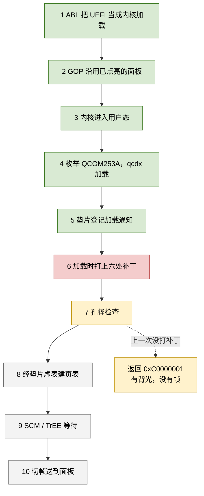
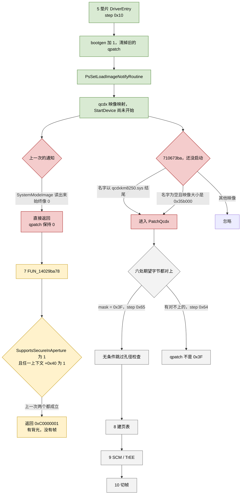
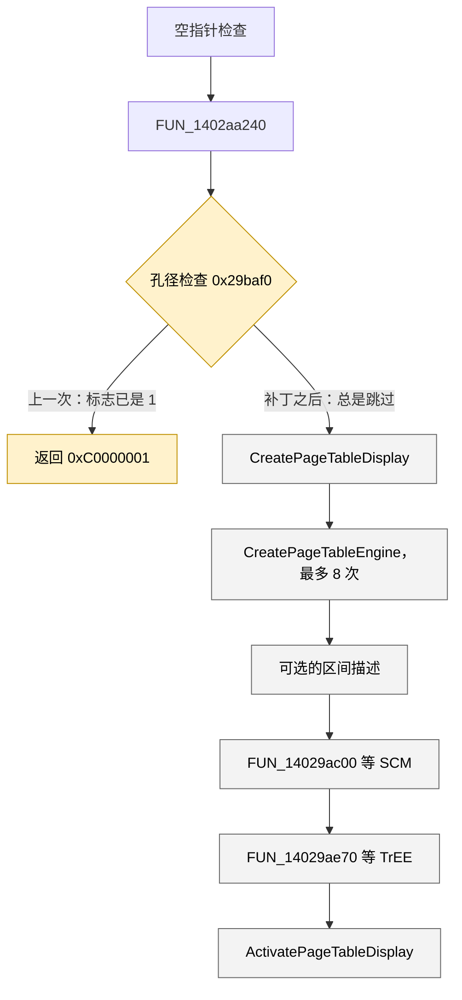
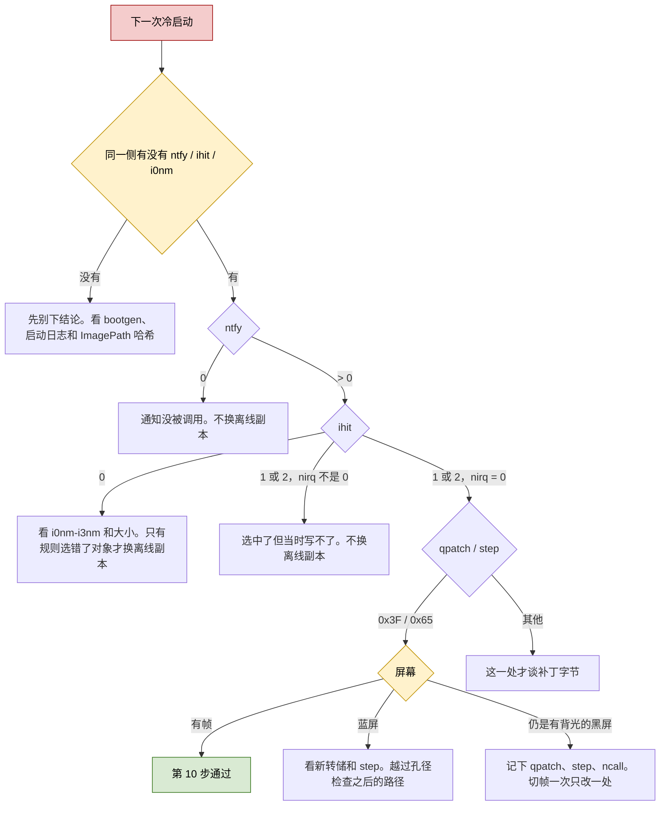

# dagu Windows GPU：进度时间线（2026-11-03）

这份文档只回答两件事：现在停在启动链的哪一步，以及哪一步还没被这次冷启动测量到。细节仍以各阶段文档为准。阶段 21 的问题码 43 已经过去，不是当前的卡点。

截至本文，平板在 Linux（B 槽，`192.168.1.51`）。A 槽这一轮没有再启动。2026-11-03 18:21 在切槽之前又读了一遍盘，整套配置单元备份在平板 `/root/pre-step6-20261103/`，主机副本在 `/tmp/dagu-boot/pre-step6/`。

---

## 1. 现在停在哪

**当前位置：垫片会在 qcdx 映射完成时打上六处补丁，匹配失败时会写下通知次数、最近四个映像和命中方式。这份带记录的垫片已经换进 DriverStore，还没有跑过一次。**

**卡点：上一次冷启动的加载通知把 qcdx 跳过了，六处补丁一处都没写。`StartDevice` 因此停在孔径检查，页表和切帧都没开始。**

上一次冷启动已经走过第 1 到第 5 步。第 6 步的修正已经落在盘上，测量它的那次启动还没做。第 7 步是上一次实际返回的地方，不是还要去找的新故障。

| | 状态 |
|---|---|
| 系统能进用户态 | 已通过。内核是硬链接的 26100.1。黑屏时没有新的蓝屏转储 |
| 面板 | 有背光，没有帧。固件把屏点亮了，Windows 没有把画面送出去 |
| qcdx | Start=3，按需启动。上一次冷启动已加载。映像是诊断版，2908336 字节，`8e77bf1e…`。仓库里的另一份不要换上去 |
| 原版 qcsmmu | Start=4，不加载。它会碰 APPS SMMU `0x15000000`，UFS 启动盘会掉 |
| 垫片 dagusmmu | Start=3。`map` 保持 0，不走实页表，不写 `0x03DA0000` |
| qcif | 上一次已加载。它发布 SCM / TrEE 接口，ioctl 返回 `0xC0000010`。映像加载不等于这些接口已经被 qcdx 打开 |
| 上一次补丁结果 | `qpatch` 仍是 0。当时的通知读错了 `SystemModeImage` 位域 |
| 已装上、还没启动的垫片 | DriverStore `710673ba…`，28336 字节。`ImagePath` 指向 `dagu-smmushim.inf_arm64_811ccbe7ca466ddc\dagu-smmushim.sys`，读回哈希就是这一份。通知回调只改内存，记录由工作项刷出，不依赖槽回调 |
| 上一版未启动过的垫片 | `552c40a9` 和会在回调里写注册表的 `62afd290…` 都已换下，副本在 `/root/pre-step6-20261103/` |
| 离线补丁副本 | `/root/pre-step6-20261103/qcdxkm8250-loadpatch.sys`，`30803ec5…`。六处已按期望值改好。DriverStore 里的 qcdx 仍是原件 `8e77bf1e…` |
| 启动前复核 | 垫片读回是 `710673ba…`，28336 字节。DSDT 39269 字节，校验和 0，有 `QCOM253A`，没有 `QCOM2509`。QCDX Start=3，qcsmmu Start=4。qcdx 仍是 `8e77bf1e…` |
| A 槽重试 | GPT 属性 `0x0032000000000000`：retry 6，successful 0，unbootable 0。再启动一次会变成 5 |
| 回到 B 槽 | 当前 `androidboot.slot_suffix=_b`。`boot_b` 属性 `0x0077000000000000`：active、successful。fastboot 里 `set-active b` 再 reboot 即可回来 |

---

## 2. 一次冷启动里的步骤

绿色是上一次冷启动已经通过的。红色是当前卡点，修正已经在盘上，还没跑。黄色是上一次实际返回的位置。灰色还没被这次冷启动碰到。

| 步 | 发生什么 | 上一次冷启动 | 盘上还没跑的修正 |
|---|---|---|---|
| 1 | ABL 把签过名的 UEFI 当成 Linux 内核加载 | 已通过 | 不改 ABL，不刷 boot |
| 2 | XBL 已经点亮面板。UEFI 的 SimpleFb 把这块帧缓冲交给 GOP | 已通过。ExitBootServices 大约 3.8 秒。源码里的 30 秒 PCIe 停顿不在已经刷进 A 槽的固件里 | 不回退这份 UEFI，也不把当前 SimpleFb 源码刷进去 |
| 3 | 内核进入用户态 | 已通过。0xA、0x6B、0xC0000428 都是版本错位，硬链接成一套 26100.1 之后不再出现 | 不换内核、不换 ntdll |
| 4 | 覆盖表追加 GPU0。PnP 枚举 `ACPI\QCOM253A\0`，qcdx 加载 | 已通过。表里有 `QCOM253A`，没有 `QCOM2509`。`_STA` 返回 `0x0F` | 不重建覆盖表。源码里的 `SupportsSecureInAperture Zero` 不是现用表，现用值是 1 |
| 5 | 垫片 DriverEntry 把 `bootgen` 加 1，清掉上一轮的 `fail` / `ncall` / `qpatch`，再登记加载通知 | 已通过。通知登记成功，所以 `step` 不是 `0x11`。`bootgen=2` 只出现在 `SYSTEM.LOG1` | 同一套登记逻辑还在 |
| 6 | qcdx 映像一映射就写六处，此时 `StartDevice` 还没运行 | **卡在这里。** 位域检查把 qcdx 跳过，`qpatch` 保持 0 | `710673ba…` 在回调里只改内存。工作项随后写下 `ntfy` / `ihit` / `i0`–`i3`，不等槽回调 |
| 7 | `FUN_14029ba78` 看孔径标志 | 两个条件都成立，返回 `0xC0000001`，后面的调用都没发生 | `0x29baf0` 改成无条件跳过。还没被测量 |
| 8 | `FUN_14029b168` 建显示页表和最多 8 份引擎页表，经 `FUN_1402aa7e0` 调垫片虚表 | 未到。页表函数的唯一调用者就是第 7 步那个函数 | `map` 仍是 0 |
| 9 | `FUN_14029ac00` 等 SCM，`FUN_14029ae70` 等 TrEE，然后做版本查询 | 未到。这两次等待排在孔径检查和页表循环之后 | 超时改成 0，版本状态改成 `0xC0000001` |
| 10 | `ActivatePageTableDisplay` / `ForceSeamlessBootTransition` 把帧送进已经点亮的面板 | 未到 | 只有 `qpatch=0x3F` 而屏幕仍黑，才轮到这里 |

### 2.1 第 6 步和第 7 步怎么连在一起

加载顺序是垫片、qcif、qcdx。垫片先登记通知。qcdx 被映射时通知先跑，qcdx 自己的 `DriverEntry` 和更后面的 `StartDevice` 都还没开始。所以上一次不是「补丁打晚了」，而是「补丁函数没被叫到」。

`FUN_14029ba78` 内部的顺序是固定的。孔径检查在页表之前，SCM / TrEE 又在页表之后：

孔径检查读的是适配器 `+0x422c`，以及 `+0xc50`、`+0x4070` 两个上下文对象各自的 `+0x40`。`+0x422c` 来自现用 `_DSD` 的 `SupportsSecureInAperture`，值是 1。两个 `+0x40` 在冷启动时已经是 1，那是固件 GOP 留下的孔径。页表函数 `FUN_14029b168` 的唯一调用者就是这个函数，所以槽回调不可能发生在这次返回之前。等第一次槽回调再打补丁，时间已经晚了。

### 2.2 六处补丁各自改什么

诊断映像的这六个字在盘上仍是期望值，补丁只写被映射进内存的那份，不改文件。

| 位 | RVA | 期望 | 改成 | 作用 |
|---|---|---|---|---|
| 0 | `0x29baf0` | `CBZ w8`，`0x34000248` | 无条件分支 `0x14000012`，目标仍是 `0x14029bb38` | 跳过孔径失败返回 |
| 1 | `0x29aca0` | `mov w2, #30000` | `mov w2, #0` | SCM 等待的超时 |
| 2 | `0x29af10` | `mov w2, #30000` | `mov w2, #0` | 另一处 30 秒等待 |
| 3 | `0x29afc4` | `mov w2, #30000` | `mov w2, #0` | 另一处 30 秒等待 |
| 4 | `0x29b070` | `mov w2, #1000` | `mov w2, #0` | 1 秒等待 |
| 5 | `0x27a420` | 立即数 `0xC0000010` | `0xC0000001` | 两次版本 ioctl 共用的比较值 |

六位全写上时 `qpatch` 是 `0x3F`，`step` 写成 `0x65`。少一位就是 `0x64`，并把「已经补过」的标志清掉。

超时改成 0 的依据是 `FUN_140284e38`：超时参数为 0 时它不调用 `KeWaitForSingleObject`，直接返回成功。接口到达回调只把打开设备的工作项排队，不会在注册通知的当时把设备对象填上。紧接着的 `FUN_140009358` 看见 `+0x28` 仍是空，返回 `0xC0000001`。`FUN_14027a130` 把这个状态装进 `w25` 比较两次；对上之后走驱动自己的「版本未实现，继续」，`StartDevice` 不拿 SCM 函数表也能往下走。

页表创建走 `FUN_1402aa7e0`，它调用的是垫片虚表，不是自己映射 SMMU 寄存器。`map` 保持 0，所以没有实页表遍历，也不写 APPS SMMU。

### 2.3 上一次冷启动实际留下的数

启动日志头是 `11  3 2026 05:56:27.639`。这是停住的 Windows 时钟，不是墙上时间。加载顺序是 `dagu-smmushim.sys`、`dagu-qcif.sys`、`qcdxkm8250.sys`，然后是 BasicDisplay。`qcsmmu8250.sys` 没有加载。屏幕是有背光的黑屏。A 槽重试从 7 减到 6，没有崩溃循环。

| 读数 | 主配置单元 | `SYSTEM.LOG1` | 怎么用 |
|---|---|---|---|
| 序号 | 7394 / 7393，单元被 fastboot 截断 | 日志头仍是 7393 / 7393 | 主单元和日志不要混成同一次写入 |
| `bootgen` | 1，和启动前修好的那份一样 | 有两处写成 2 | 2 说明新垫片的 DriverEntry 跑过 |
| `qpatch` | 0 | 这个值名不在日志里 | 这次启动没有写下补丁掩码 |
| `step` | `0x30` | 里面还有更早的 `0x64` / `0x40` | 主单元的 `0x30` 是截断前的旧值，表示接口已启用 |
| DSDT | 六段都在，39269 字节，校验和 0 |  | `QCOM253A` 在，`QCOM2509` 不在 |
| QCDX | Start=3，Type=1，ErrorControl=0 |  | 诊断映像路径还在 |

`0x30` 只表示三个设备接口注册并启用了。它不表示 qcdx 已经查询过接口，也不表示补丁写过。槽回调会把 `step` 刷到 `0x60`。上一次主单元里看不到这次启动新写的 `0x60` 或 `0x65`。

---

## 3. 历史时间线

### 10 月 29–30 日：让驱动认到这块 GPU

| 日期 | 阶段 | 结果 |
|---|---|---|
| 10-29 | 0 | 注册表覆盖表能枚举测试设备。qcdx 的依赖表列出来了 |
| 10-29 | 1–2 | 第一版 PEP 直接蓝屏。`SOSI` 被编成 4 字节会变成 `0x1A`。全仓只有 `QCOM253A` 有显示驱动，据此做了 GPU0 |
| 10-30 | 3–4 | PEP 用的 HID 没有 INF。装上 `QCOM253A` 后设备显示成 Adreno 640，启动卡在 qcdx 加载之后，没有转储 |
| 10-30 | 5–7 | PEP 实验 A/B/C 没把这次卡死解释掉。处理器空闲门控在当前开关下不注册 |

### 10 月 30–31 日：补 ACPI，并确认原版 SMMU 不能加载

| 日期 | 阶段 | 结果 |
|---|---|---|
| 10-30 | 8 | 补上 `ENGS` / `RESI` / `TMDT`。没有 `GmuInternal` 和 `GpuInternal`，初始化会直接返回 |
| 10-31 | 9 | 补上 `PMCL` / `_HRV`。当时还没上板 |
| 10-31 | 10、12 | 覆盖表里一旦出现 `QCOM2509`，原版 qcsmmu 会在启动早期拆掉 UFS。覆盖表从此只留 GPU0 |
| 10-31 | 11、15 | 运行时拉起能进 qcdx。缺 `REGR` 时是空指针；补上之后开始等 SMMU 设备接口 |
| 10-31 | 13 | UEFI 给 GPU CX 上电，大核调频修好 |
| 10-31 | 14–19 | Adreno SMMU 多数寄存器可以从 HLOS 写。原版 qcsmmu 的活页表遍历会经 QHEE 整机复位。`map` 因此保持 0 |

### 11 月 2 日：垫片代替 qcsmmu，用户态恢复

| 时间 | 阶段 | 结果 |
|---|---|---|
| 白天 | 20 | 垫片注册 GPU、显示、视频三个设备接口，查询缓冲 `0x1A0`，版本 2。不映射 `0x15000000`。运行时拉起收到槽回调，随后在高 IRQL 上空指针。当时 `QCDX` 被留在 Start=3 |
| 晚间 | 21 | 第 25 槽改成交回子区间对象，不再把内核地址当成区间长度。运行时重启后问题码 43 消失：`subok=1`，`suboff=0x9C000000`，`subsz=0xFA0000`（1600×2560×4），`ncall=160`，`step=0x60`。那次没有做冷启动验证 |
| 夜里 | 启动链 | 旧 ESP 引导文件、内核 26100.9457、ntdll 和内核不是同一套，先后挡住用户态。硬链接成一套 26100.1 之后能进桌面。那次桌面可见时，垫片收到过槽回调 |

阶段 21 的运行时成功和后来的冷启动黑屏不矛盾。运行时拉起时孔径路径已经走过，或者当时的标志没有在 `StartDevice` 入口把函数打回去。冷启动时 GOP 把 `+0x40` 留成 1，未打补丁的 `FUN_14029ba78` 在任何槽回调之前返回。

### 11 月 3 日：冷启动变成有背光的黑屏

| 顺序 | 做了什么 | 读到什么 |
|---|---|---|
| 1 | 去掉 UEFI 里 30 秒 PCIe 停顿 | ExitBootServices 大约 3.8 秒。画面问题还在。A 槽上的 UEFI 是 `f1d11953…`，这次不刷 |
| 2 | 垫片每次启动写 `bootgen`，并清掉上一轮的 `fail` / `ncall` / `qpatch` | 用来把旧的 `fail=0xC0000001`、`ncall=58` 和这一代分开。那份只做记号的垫片是 25264 字节，`14e32bb8…` |
| 3 | 一次 A 槽冷启动 | qcdx 没出现在 `05:56:17` 那段启动日志里。覆盖表被截成第一段，配置单元序号也不一致 |
| 4 | 从 `SYSTEM.bak-qcdx4` 把六段 DSDT 和 QCDX Start=3 接回去 | 表长 39269，校验和 0。下一次启动重新加载 qcdx |
| 5 | 加载通知里打六处补丁，再冷启动一次。跑的是 `bf010d25…` | 日志头 `05:56:27`。qcdx 已加载。屏幕有背光、没有帧。`bootgen` 只在日志里变成 2。`qpatch` 仍是 0 |
| 6 | 反编译孔径检查、等待函数、版本查询和页表调用 | 六处期望字节保持不动。上一轮没打上，是因为 `IMAGE_INFO` 的位域布局和通知实际读取的不一致 |
| 7 | `552c40a9` 写入 DriverStore | 匹配失败时不留原因。18:24 的 `62afd290…` 在回调里写注册表。18:36 换成 `710673ba…`，记录改由工作项刷出，还没有启动 |

---

## 4. 已经有结论、先不要再动

- 黑屏时机器停在用户态，不是蓝屏，也不是 26100.1 这套文件的版本错位。
- 背光已经亮着。Linux 下把亮度从 400 调到 1500 只解释 Linux 自己的暗屏。
- A 槽里的 UEFI 已经没有 30 秒 PCIe 停顿。当前仓库里的 SimpleFb 源码和刷进去的那份不是同一份，现在不刷。
- 原版 qcsmmu、PEP、`map=1`、活页表遍历会拆启动盘或经 QHEE 复位。这一步用垫片代替它们。
- Zap、GX、面板 `_ROM` / `PCFG` 仍延后。第 6 步还没测过。
- `QCDX` 保持 Start=3。运行中把它改成 4，PnP 会停掉已经起来的设备。qcdx 还在跑时不要停垫片。

---

## 5. 下一次启动要看的数

只在决定测量第 6 步时再切 A 槽。Windows 不会把这一槽标成成功。先整份读主单元、`SYSTEM.LOG1`、`SYSTEM.LOG2`，找出哪一侧含有比备份更新的 `bootgen`，然后只解读那一侧里的 `qpatch`、`step`、`ntfy`、`ihit`。不要拿主单元的 `step` 和日志里的 `qpatch` 拼在一起。

这次读盘时主单元序号仍是 7394/7393，`bootgen` 是 1，`step` 是 `0x30`，`qpatch` 是 0。`SYSTEM.LOG1` 序号 7393/7393，里面有上一轮写下的 `bootgen=2`。`SYSTEM.LOG2` 是空文件。`bootgen` 只用来分代：读到 2 既可能是新垫片从 1 加出来的，也可能是旧日志。证明 `710673ba…` 跑过的是旧垫片从没写过的 `ntfy`、`ihit`、`i0nm`。这些新值名和 `bootgen` 仍然只在同一侧里一起读。

通知回调不写注册表。它把次数、名字、大小和补丁掩码留在内存里，并排队一个工作项。工作项在回调返回之后、PASSIVE 上刷盘，不经过槽回调。孔径检查提前返回、`step` 停在 `0x30` 时，这些记录仍然会落盘。

`PatchQcdx` 看到期望值或已经是补丁值都算这一位置通过。六处都已经是补丁值时，结果仍是 `qpatch=0x3F`、`step=0x65`，不是 `0x64`。离线副本 `30803ec5…` 和原件 `8e77bf1e…` 都是 2908336 字节，只有那六个指令共 11 个字节不同。DriverStore 里的 qcdx 仍是原件。换上离线副本时不必先改垫片。

| 项 | 含义 |
|---|---|
| `ntfy` | 这次启动里加载通知被调用的次数。只在映像不小于 `0x29c000`，或名字里带 `qcdx` 时刷进注册表 |
| `ihit` | 0 没选中；1 按 `qcdxkm8250.sys` 这个结尾选中；2 名字为空且映像大小正好是 `0x35b000` |
| `nirq` | 选中那一次的 IRQL。0 是 PASSIVE，补丁函数才会写。非 0 表示选中了但没写 |
| `iseq` | 记下来的映像个数。最后一条在槽 `(iseq - 1) mod 4` |
| `i0nm`–`i3nm` / `i0sz`–`i3sz` | 最近四个候选映像的路径尾巴和大小 |
| `qpatch` | `0x3F` 六处都写上。0 是没进写循环，或六处都没对上期望字节 |
| `step` | `0x65` 六处都写上；`0x64` 有对不上的；`0x30` 只启用了接口；`0x11` 通知没登记上 |

同一侧找不到 `ntfy`、`ihit`、`i0nm` 时，先别下结论。垫片可能没跑，也可能跑了没落盘。用这一侧有没有比 1 更大的新 `bootgen`、启动日志里的加载顺序，以及 `ImagePath` 指向的文件哈希一起看。落盘存疑就再等一次，不把它当成匹配规则的问题。

新值名在同一侧出现之后，按这个顺序读，只有最后一种才谈补丁效果：

1. `ntfy=0`：通知没被调用。问题在登记，和匹配无关。不换离线副本。
2. `ntfy>0` 且 `ihit=0`：通知跑了但没选中。看 `i0nm`–`i3nm` 和对应大小。只有这些名字和大小说明匹配规则选错了对象，才换 `qcdxkm8250-loadpatch.sys`。
3. `ihit` 为 1 或 2，且 `nirq` 不是 0：选中了，但当时写不了。补丁时机的问题。不换离线副本。
4. `ihit` 为 1 或 2，且 `nirq=0`：这时才读 `qpatch` 和 `step`。

工作项写完 `qpatch` 后走 `Step`，`Step` 里有 `ZwFlushKey`。没选中时工作项自己调用 `ZwFlushKey`。键在刷出时已经提交，不必为了等惰性写再空等一两分钟。

`qpatch=0x3F` 之后如果蓝屏，看有没有新的 `MEMORY.DMP`，以及 `step` 停在哪。这是越过孔径检查之后的路径，和以前的版本错位不是一件事。屏幕仍黑就把这次的 `qpatch`、`step` 和 `ncall` 一起记下来，再决定切帧里动哪一处，一次只动一处。在 `qpatch` 到 `0x3F` 之前，不改 GOP，不刷 UEFI，不把 `map` 设成 1。
